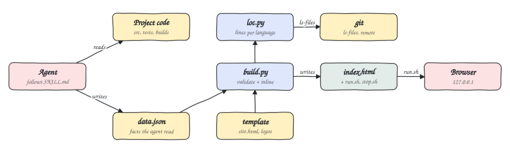
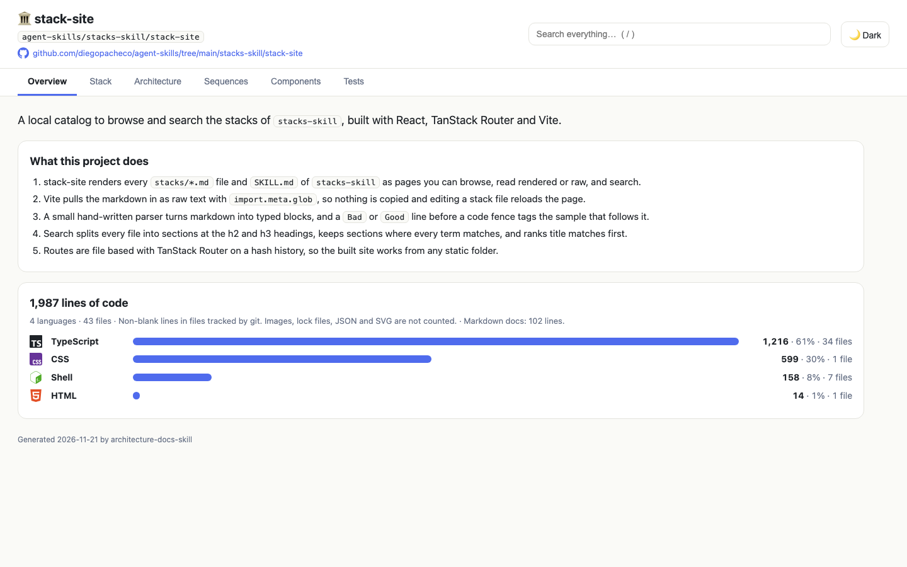
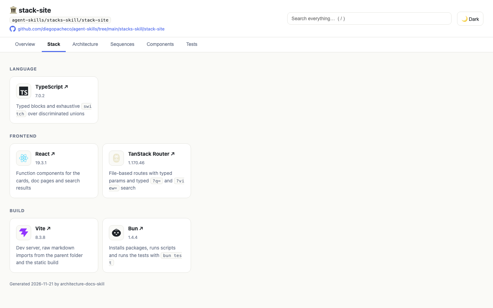
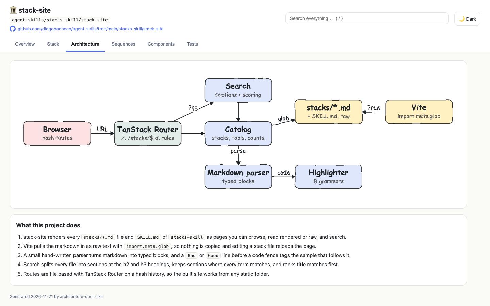
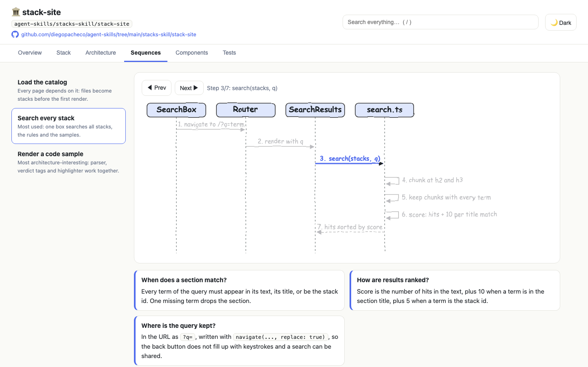
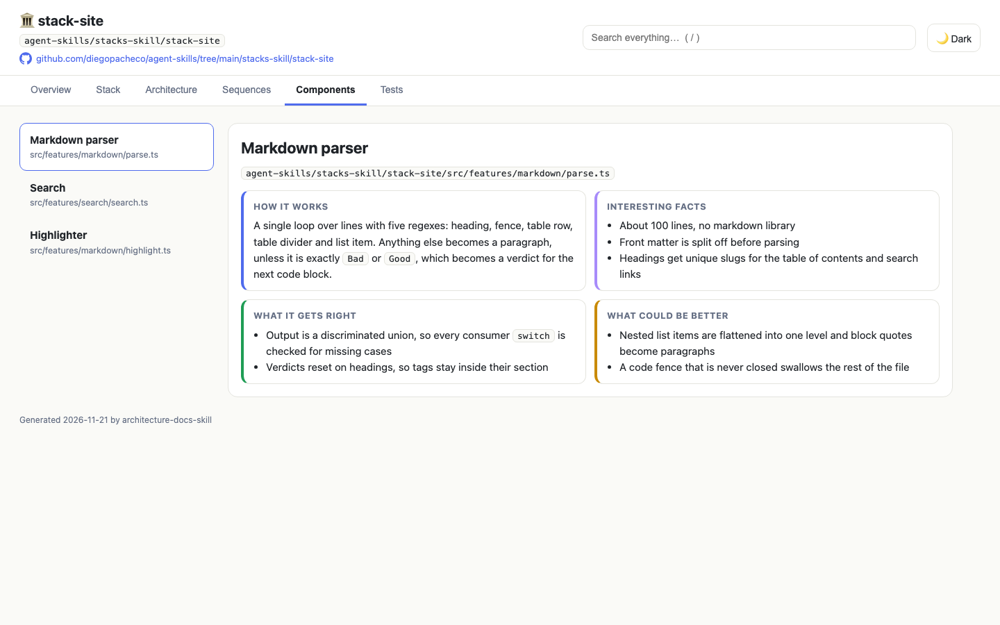
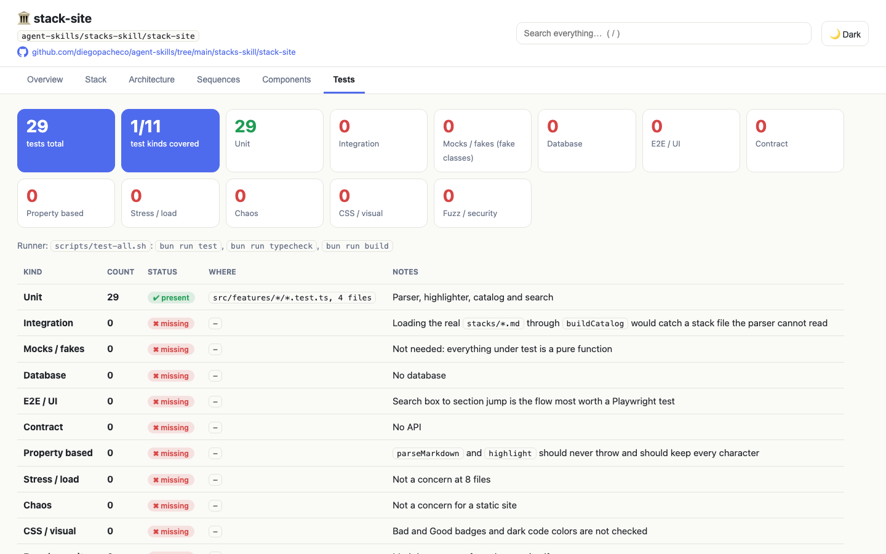
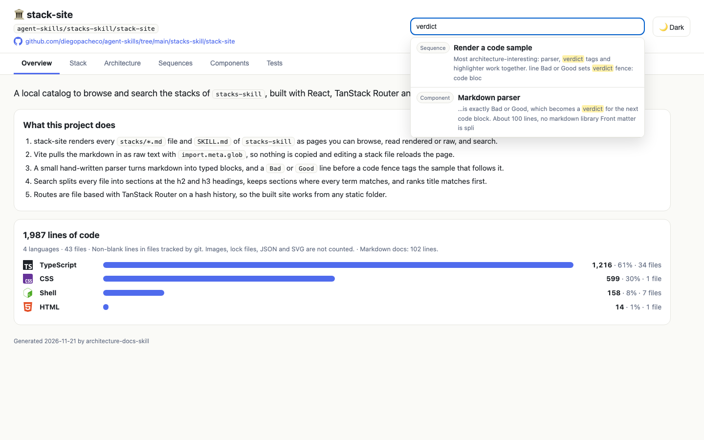
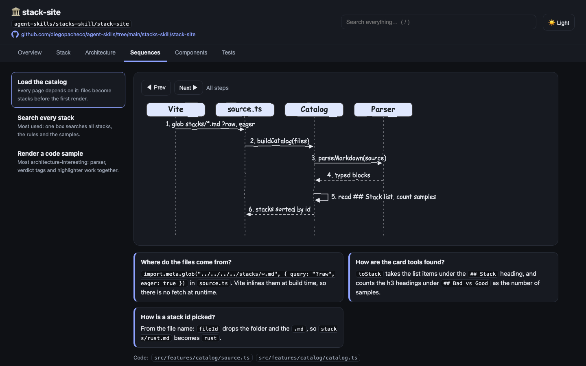

# architecture-docs-skill

A skill for Claude Code and Codex that reads a codebase and generates a self-contained architecture website: the stack with logos and links, lines of code per language, a hand-drawn architecture diagram, the 3-5 most critical sequence diagrams with notes, a drill down of the 3-5 most interesting components, and a test analysis with a counter per test kind. One `index.html` with everything inlined, searchable, with light and dark themes, plus `run.sh` and `stop.sh`.

## How it Works?

1. You run `/architecture-docs-skill` in a project, or ask the agent to document its architecture.
2. The agent follows `SKILL.md`: it reads the build files, entry points and code, follows the critical flows through the code, reads the chosen components fully, and counts the tests per kind.
3. It writes everything it found into one `data.json`: stack, architecture nodes and edges, sequences with notes, components, test counts.
4. `scripts/build.py` validates the data: every component path and code file must exist in the project, every sequence step must use a known actor, two diagram nodes cannot share a cell, a missing test kind cannot have a count. Any error stops the build.
5. `scripts/loc.py` counts the non-blank lines per language from the files git tracks, and the build reads the GitHub URL from the git remote. The agent never types those numbers.
6. The build inlines the data, the template and only the logos the site uses into one `index.html`, and writes `run.sh` and `stop.sh` next to it.

## Architecture



## Features

* **Overview:** 3-5 lines on what the project does and the lines of code per language with logos, file counts and percentages, so you see the size and shape first.
* **Stack:** one card per technology, grouped by layer, with its logo, version, link to its site and why the project uses it.
* **Architecture:** a hand-drawn diagram laid out left to right in request order, colored by kind (actors, edges, core, data, external).
* **Sequences:** 3-5 flows picked because they are critical, most used or architecturally interesting. Prev / Next walks the diagram one step at a time, and notes under it answer the questions the diagram raises with the real query, column or constant.
* **Components:** 3-5 deep dives, each with the full path to the code and four boxes: how it works, interesting facts, what it gets right, what could be better.
* **Tests:** counters for 11 test kinds (unit, integration, mocks / fakes, database, E2E / UI, contract, property based, stress / load, chaos, CSS / visual, fuzz / security), the command that runs them, and where each missing kind would pay off.
* **Header:** the full path of the project (click to copy) and its GitHub link when the remote is on GitHub.
* **Search:** `/` or `Cmd+K` searches every section, highlights matches and jumps to them.
* **Themes:** light and dark, remembered across visits.
* **Fails loud:** the build rejects invented files, unknown actors, overlapping nodes and contradicting test counts instead of rendering a wrong site.

## Stack

* Python 3 standard library: `build.py` and `loc.py`, nothing to install.
* HTML, CSS and JavaScript with no framework and no CDN: the site works offline and from disk.
* Inline SVG with a turbulence filter: the hand-drawn look of the diagrams.
* [Simple Icons](https://simpleicons.org) (CC0): 206 technology logos in `template/logos.json`, embedded only when used.
* Bash: `install.sh`, `uninstall.sh`, `test.sh` and the generated `run.sh` / `stop.sh`.

## Contracts

`data.json`, written by the agent, read by `scripts/build.py`. The full field rules are in [SKILL.md](SKILL.md).

| Field | What it holds |
|---|---|
| `project`, `path`, `tagline` | Name, absolute project folder, one-line description |
| `summary` | 3-5 lines on what the project does |
| `stack[]` | `layer`, `name`, `version`, `logo` (Simple Icons slug), `url`, `why` |
| `arch.nodes[]` / `arch.edges[]` | Nodes with `kind`, `col`, `row`; edges as `[from, to, label]` |
| `sequences[]` | `actors`, `steps` as `[from, to, label]`, `notes` as `{q, a}`, `code` files |
| `components[]` | `path`, `how`, `facts`, `right`, `better` |
| `tests` | `runner` and `kinds[]` with `kind`, `status`, `count`, `where`, `note` |

The build adds `loc`, `repo` and `generated`. Text wrapped in backticks renders as code; everything else is escaped.

## Design decisions

* **Facts from scripts, prose from the agent.** Lines of code and the GitHub URL come from git, not from the agent, so they are always right.
* **Validation over trust.** The build checks every path the agent wrote against the disk. A hallucinated file stops the build.
* **One file.** Data, CSS, JS and logos are inlined, so the site can be copied, mailed or opened from disk.
* **Grid layout for diagrams.** The agent places nodes on columns and rows instead of pixels; the template computes positions, arrows and label fitting.

## How to install

```bash
./install.sh            # asks: Claude, Codex or both
./install.sh claude     # or codex, or both
./uninstall.sh          # asks which one to remove
```

## How to use

In any project:

```
/architecture-docs-skill
```

The site is written to an `architecture-docs/<project>/` folder in your home directory:

```bash
architecture-docs/<project>/run.sh    # serves on 127.0.0.1 from port 8790 and opens the browser
architecture-docs/<project>/stop.sh   # stops it
```

`index.html` also opens straight from disk. To build by hand from a `data.json`:

```bash
python3 scripts/build.py path/to/data.json [out-dir]
python3 scripts/loc.py path/to/project
```

## How to run the tests

```bash
./test.sh
```

16 tests cover the line counter (blank lines, lock files, dependency folders, git-tracked files only, Markdown as docs), the GitHub URL from SSH and HTTPS remotes, every validation rule, the single-file output with executable scripts, script-tag escaping, the logo subset, and that the same data always builds the same file.

## Printscreens

Generated for [stacks-skill/stack-site](../stacks-skill/stack-site), the stack catalog in this repo. The local part of the project path was removed from the screenshots.

**Overview:** what the project does in five lines, then 1,987 lines of code across TypeScript, CSS, Shell and HTML with file counts.



**Stack:** one card per technology grouped by layer. Each card links to the project site.



**Architecture:** the browser hits TanStack Router, which drives search and the catalog; the catalog parses the markdown that Vite pulls in raw.



**Sequences:** the search flow at step 3 of 7 with Prev / Next. The step is highlighted and the others fade. Notes under the diagram explain how a section matches, how results are ranked and where the query lives.



**Components:** the markdown parser with its full path and the four boxes.



**Tests:** 29 unit tests, 1 of 11 kinds covered, and for each missing kind the place where it would pay off.



**Search:** typing `verdict` finds the sequence and the component that mention it, with the match highlighted.



**Dark theme:** the sequences tab in dark.


