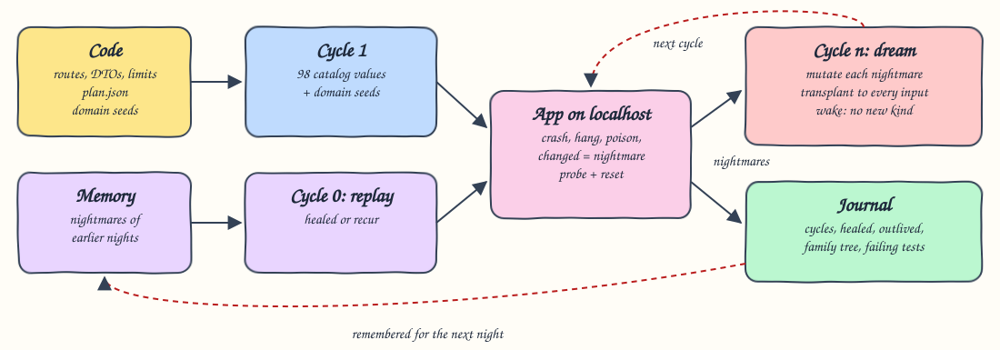
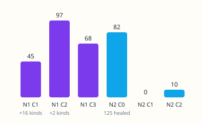
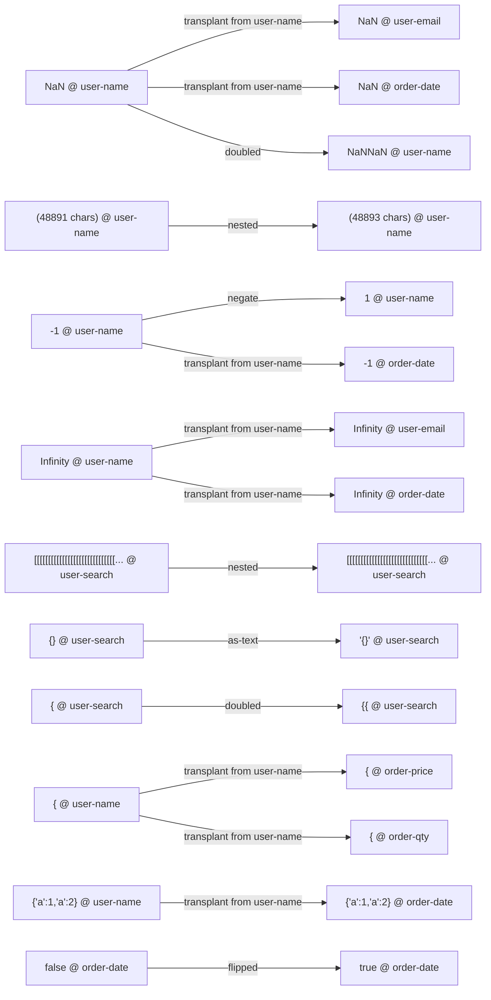

<p align="center"></p>

# data-dream

A skill for Claude Code and Codex that dreams up the data your users will send one day and keeps dreaming. The first cycle fires a catalog of 98 nasty values at the app on localhost. Every value that hurts the app becomes a nightmare, and every next cycle dreams new values from those nightmares, until a whole cycle finds nothing new. Nightmares are remembered across nights, so the next night shows what your fixes healed and which dreamed values still break the app. It leaves a dream journal with a family tree of every value and one failing test per finding. It never fixes production code.

## What problem it solves

Apps are tested with the data their developers imagine. Production sends everything else, and four problems follow:

1. **Untested data**: names with emoji, a price of `-1`, a date in Kiribati at +14:00, an empty JSON body, `2.675` that rounds the wrong way. The happy path tests pass and production returns 500, stores garbage, or loses a cent.
2. **Edge case lists only cover what was written down, where it was aimed**: someone tries `NaN` on the price and never on the email. The same bug sits in every input that reads a body.
3. **One bad write breaks a read for everyone**: an order with a strange date is accepted with 201, and from then on the revenue report fails for every day. Testing the order endpoint alone never sees it.
4. **Fixes are partial and nobody checks again**: a developer fixes the one value from the bug report, the bug is closed, and the next strange value breaks it the same way.

data-dream finds these before users do, proves each one with a failing test, and checks again every night.

## How dreaming helped

The catalog alone handles part of problem 1. Dreaming handles the rest. Everything below is from the [sample](#sample), two real nights on a small shop API:

| Problem | Catalog alone | What dreaming added |
|---|---|---|
| Untested data | 300 values fired, 45 broke the app | 472 more values dreamed from those 45, and 165 of them broke the app too. Each dreamed value is a variation of a value that already hurt, like `-1` turned into `1`, `[-1]` or `"-1"` |
| Lists aimed at one input | 0 breaks on the email input | 8 breaks on the email input, from `NaN`, `Infinity` and `{` moved over from the name. Invalid JSON crashes every input that reads a body, not only the one the list was aimed at |
| One write breaks a read | 5 order dates broke `/revenue` | 50 more. The bug is not "a missing date": any date that is not text (numbers, objects, `true`) takes revenue down |
| Partial fixes | After the developer's fixes, 2 catalog values still broke `/revenue` | 42 dreamed values still broke it, among them `true`, a kind the catalog never tried. The memory replayed all 207 values from night 1, so the fixes that held (125 healed) and the one that did not are both on record |

The most concrete result is the DD9 test. Before dreaming it only sent a missing `createdAt`, and the developer's half fix `if (!createdAt)` would have passed it: the bug would have shipped as fixed. With the dreamed values it fails on the half fixed code until the fix is real.

What dreaming did not do:

* Night 2 found no new kind of breakage, so the remaining risk is in what is already listed.
* 6 of the 10 findings (wrong totals, negative prices, duplicate emails, blank names, 1 MB names, dates on the wrong day) are accepted with 201 and break nothing at once. The script cannot see them. The agent found them by reading the responses and the code.

## The dreaming technique

Dreaming is how the brain replays the day and recombines it into things that never happened. data-dream does the same with data:

| Dreaming | In data-dream |
|---|---|
| Day residue | Cycle 1 fires the catalog and the domain seeds read from the code |
| Nightmare | A value that crashes, hangs, poisons another endpoint or comes back changed |
| Recombination | Each next cycle mutates the nightmares of the cycle before (negate, tiny, huge, as text, in a list, doubled, upper, padded, half, flipped, emptied, nested) and transplants each one to every other input |
| Waking up | A cycle that finds no new kind of nightmare ends the night. A kind is input + verdict + status + shape of the value |
| Memory | Nightmares are kept across nights and replayed first. They heal or recur, and the ones that recur are dreamed on |
| Dream journal | One section per night: a table per cycle, healed and still broken kinds, dreams that outlived a fix, and the family tree of every dreamed value back to the catalog value it came from |

## How it Works

1. The agent maps the input surfaces with `file:line` and writes `domain-seeds.json` with the exact limits it read in the code.
2. It writes `plan.json`: one target per input with its URL, a template where `@@` is the value, the catalog categories, an `echo` field that must come back as sent, and a `probe` read that must keep working after the write.
3. `dream.mjs dream` replays the memory, runs cycle 1 from the catalog, then dreams cycle after cycle. It restarts the app with `reset` when a probe goes down, and stops loudly if the restart does not bring it back.
4. It writes the memory, `journal.md` and `dream-chart.svg`.
5. The agent judges what only the domain can tell (wrong results, silent accepts) and writes one failing test per root cause, using the dreamed values too.
6. The next night, after a fix, the replay shows what healed and what recurs.

## Architecture

<p align="center"></p>

## Features

* **Dream cycles**: values nobody wrote down come from recombining the ones that already hurt, so one crash in the name leads to the same value tried on every other input.
* **Memory across nights**: a partial fix is caught because the dreamed values that still break the app are replayed the next night.
* **Family tree**: every dreamed value points back to its parent and the operation that made it, down to the catalog value.
* **Poison detection**: a write that is accepted and then breaks a read (one order that takes down revenue) is found through the probe.
* **Changed detection**: `echo` catches values the app stores differently than it got them.
* **98 values, 9 categories**: unicode, size, numbers, time, empty, money, text, identity, structure, each with why it breaks things.
* **Localhost only**: every URL of the plan must be `localhost`, `127.0.0.1` or `[::1]`.
* **Proof or nothing**: no failing test, no finding. One finding per root cause.
* **scripts-skill aware**: `start-all.sh`, `stop-all.sh` and `status.sh` start, reset and check the app.
* **Git like git-gh-skill**: its own branch, commits prefixed with the project name, merge only, never rebase, never push.

## Stack

* **Node.js, zero dependencies**: `scripts/dream.mjs` uses `node:http` with a fresh connection per request, so a restarted app never sees a stale socket.
* **JSON catalog, plan and memory**: easy to read, diff and extend.

## Commands

| Command | What it does |
|---|---|
| `dream.mjs dream --plan plan.json [--journal data-dream/journal.md] [--memory ~/.data-dream/<repo>/memory.json] [--cycles 5] [--max 60] [--timeout 3000]` | One night: replay, catalog, dream cycles, journal and chart |
| `dream.mjs categories` | Lists the categories and how many values each has |
| `dream.mjs seeds <dir> [--only unicode,money]` | Writes one seed file per category |
| `dream.mjs fire --url http://localhost:PORT/path --seeds <dir\|file> [--method POST] [--template '{"name":@@,"email":"@@id@shop.io"}'] [--out results.json]` | Fires one seed file at one input by hand |

## Design decisions

* New values are only dreamed from nightmares, never from values that were fine, so each cycle stays small and on target. `--max` caps the dreamed values per input per cycle.
* The same value is never fired twice at the same input in one night.
* Values longer than 8000 characters are not put in URLs: servers refuse them before the app runs, which says nothing about the app.
* Memory keeps values up to 4 KB. Larger ones are recorded by length and not replayed.
* The script judges only what it can be sure of: crash, hang, poison and changed. Wrong results and silent accepts need the domain, so the agent judges them.

## Sample

[`sample/`](sample) is a small shop API (users, search, orders, daily revenue) with the scripts-skill set and 4 happy path tests that pass. data-dream dreamed two nights on a git copy of it, for real. Between the nights a developer fixed some findings by hand ([the patch](sample/results/night-2-fixes.patch)): invalid JSON now returns 400, a name must be text, and `createdAt` is required with `if (!createdAt)`. Everything is in [`sample/results/`](sample/results): the [plan](sample/results/plan.json), the [journal](sample/results/journal.md), the [memory](sample/results/memory.json), the [report](sample/results/report.md), the [failing tests](sample/results/data-dream.test.mjs) and the [transcript of both nights](sample/results/dream-transcript.md).

### Results in numbers

**Night 1: what the dreams added on top of the catalog**

| | Catalog only (cycle 1) | Dreams (cycles 2 and 3) | Night 1 total |
|---|---|---|---|
| Values fired | 300 | 472 | 772 |
| Nightmares (values that broke the app) | 45 | 165 | 210 |
| Kinds of nightmare | 16 | 2 new | 18 |
| user-name | 26 | 69 | 95 |
| user-email | 0 | 8 | 8 |
| user-search | 9 | 28 | 37 |
| order-price | 3 | 5 | 8 |
| order-qty | 2 | 5 | 7 |
| order-date | 5 | 50 | 55 |

The catalog never broke the email input. The dreams broke it 8 times, by moving `NaN`, `Infinity` and `{` over from the name input. That is 1 of the 2 new kinds, and the order date is the other.

**Night 2, after the developer's fixes: did they hold?**

| | From the catalog | From the dreams | Total |
|---|---|---|---|
| Night 1 nightmares replayed | 44 | 163 | 207 |
| Healed (now a clean 400) | 32 | 93 | 125 |
| Still broken | 12 | 70 | 82 |
| Still broken on order-date (the DD9 fix) | 2 (`{}`, `1717243200000`) | 42 (`true`, `-1`, `2.675`, `{"__proto__":...}` ...) | 44 |
| Kinds still broken that only dreams had | - | 1 (`true`, a boolean) | 1 |

3 of the 210 night 1 nightmares are over 4 KB, so the memory keeps their length only and does not replay them.

What this shows:

* **The fixes for DD1 and DD2 held**: every name nightmare and every invalid JSON body healed, both the catalog ones and the dreamed ones.
* **The DD9 fix did not hold**: `if (!createdAt)` healed `null`, `false`, `0` and a missing field, but 44 values still take down `/revenue`. The catalog alone would show 2 of them. The dreams show 42 more, and one whole kind (`true`) the catalog never tried.
* **DD3 was not fixed**, and its search crashes recur as expected.
* **Night 2 found nothing new**: 256 catalog values and 210 dreamed ones produced no new kind, so the remaining risk is in what is already listed.

<p align="center"></p>

**Night 1**: woke after cycle 3, when no new kind of nightmare showed up.

| Cycle | Dreams | Fired | Nightmares | New kinds |
|---|---|---|---|---|
| 1 | catalog and domain seeds | 300 | 45 | 16 |
| 2 | dreamed from cycle 1 | 187 | 97 | 2 |
| 3 | dreamed from cycle 2 | 285 | 68 | 0 |

Night 1 family tree, each arrow is one dream:



**Night 2**, after the fixes: the memory replayed 207 nightmares first.

| Cycle | Dreams | Fired | Nightmares | New kinds | Healed |
|---|---|---|---|---|---|
| 0 | replay of night 1 | 207 | 82 | 0 | 125 |
| 1 | catalog and domain seeds | 256 | 0 | 0 | 0 |
| 2 | dreamed from cycle 1 | 210 | 10 | 0 | 0 |

The fixes healed 125 values, including every invalid JSON crash on all five inputs. The `createdAt` fix did not hold: 44 values still take down revenue for every day, 2 from the catalog and 42 from the dreams. The journal points at the first dreamed value of each kind that outlived the fix:

* `true` on order-date ⟵ flipped ⟵ `false` on order-date (catalog empty-9)
* `-1` on order-date ⟵ transplant from user-name ⟵ `-1` on user-name (catalog numbers-3)

`if (!createdAt)` stops `false`, `0`, `null` and a missing field, but lets objects, numbers and `true` through. The first DD9 test only sent a missing `createdAt`, so this half fix would have passed it. It now sends the values from the journal (`undefined`, `null`, `{}`, `true`, `-1`, `1717243200000`), and it fails on the sample and on the half fixed copy.

10 findings, each with a test that fails today:

| Id | Verdict | Finding | Seed that shows it |
|---|---|---|---|
| DD9 | crash | One order without a valid `createdAt` makes `/revenue` return 500 for every day | `empty-10` missing field |
| DD8 | wrong | `toFixed` stores 2.675 as 2.67 | `money-3` 2.675 |
| DD7 | silent accept | Negative and infinite prices are stored | `money-4` -10.00, `numbers-8` 1e309 |
| DD6 | silent accept | `ANA@shop.io` and `" ana@shop.io"` register next to `ana@shop.io`, and `1.5` is accepted as an email | domain seeds |
| DD3 | crash | Search builds a regex from the query, so `(`, `+` and `{` crash it | `text-2` Robert'); DROP... |
| DD10 | wrong | `2023-02-29` is stored, and a +14:00 order counts on the wrong UTC day | `time-2`, `time-11` |
| DD1 | crash | A number, list or object name crashes `name.trim()` | `numbers-3` -1 |
| DD2 | crash | Invalid JSON bodies return 500 instead of 400 | `structure-6` { |
| DD5 | silent accept | A 1 MB name is stored | `size-5` |
| DD4 | silent accept | A name made only of spaces is stored as `""` | `empty-3` |


`test.sh` checks that these results are real: the sample's own tests pass, all 10 finding tests still fail against it, the journal is exactly what the memory renders, and the memory holds two nights with the dreams that outlived the fix.

The sample runs also found bugs in data-dream itself, now fixed and covered by tests: a lone surrogate crashed URL encoding, removing the first field of a template left a dangling comma, keep-alive sockets went stale across a restart, and `JSON.stringify(Infinity)` hid a changed value. They found one in the sample's `stop-all.sh` too: it returned before the port was free.

## How to run

```
./install.sh            asks for Claude, Codex or both
./install.sh claude     or codex, or both
./uninstall.sh both
./test.sh               runs the tests
```

Then in a repository: `/data-dream` in Claude Code or `$data-dream` in Codex.
