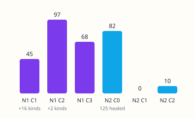
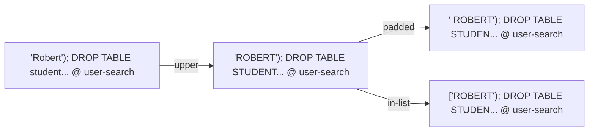
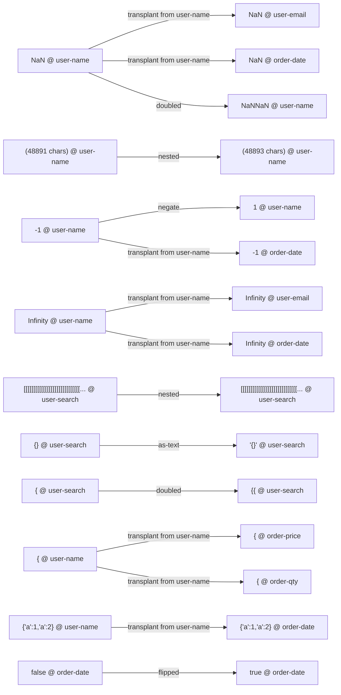

# data-dream journal

## Night 2 · 2026-11-24 · woke: no new kind of nightmare in cycle 2

| Cycle | Dreams | Fired | Nightmares | New kinds | Healed |
|---|---|---|---|---|---|
| 0 | replay of earlier nights | 207 | 82 | 0 | 125 |
| 1 | catalog and domain seeds | 256 | 0 | 0 | 0 |
| 2 | dreamed from cycle 1 | 210 | 10 | 0 | 0 |

### Healed since the night before (125 values)

| Kind | Values healed | Now | One of them |
|---|---|---|---|
| user-name crash 500 number | 53 | rejected | `-1` |
| user-name crash 500 array | 28 | rejected | `[[[[[[[[[[[[[[[[[[[[[[[[[[[[[...` |
| user-email crash 500 invalid | 8 | rejected | `NaN` |
| user-name crash 500 invalid | 7 | rejected | `NaN` |
| order-price crash 500 invalid | 7 | rejected | `NaN` |
| order-qty crash 500 invalid | 7 | rejected | `NaN` |
| order-date crash 500 invalid | 7 | rejected | `NaN` |
| user-name crash 500 object | 4 | rejected | `{}` |
| order-date poison 201 null | 1 | rejected | `null` |
| order-date poison 201 boolean | 1 | rejected | `false` |
| order-date poison 201 missing | 1 | rejected | `(missing)` |
| order-date poison 201 number | 1 | rejected | `0` |

### Still broken from earlier nights (82 values)

| Kind | Values | First dreamed | One of them |
|---|---|---|---|
| order-date poison 201 number | 39 | night 1, cycle 1 | `1717243200000` |
| user-search crash 500 string | 22 | night 1, cycle 1 | `"Robert'); DROP TABLE student...` |
| user-search crash 500 array | 9 | night 1, cycle 1 | `[[[[[[[[[[[[[[[[[[[[[[[[[[[[[...` |
| user-search crash 500 object | 4 | night 1, cycle 1 | `{}` |
| order-date poison 201 object | 4 | night 1, cycle 1 | `{}` |
| user-search crash 500 invalid | 2 | night 1, cycle 1 | `{` |
| order-price changed 201 number | 1 | night 1, cycle 1 | `1e309` |
| order-date poison 201 boolean | 1 | night 1, cycle 2 | `true` |

### Dreams that outlived a fix (2)

A fix healed other values of these kinds, but a value the dreams invented still breaks the app.

* `-1` on order-date ⟵ transplant from user-name ⟵ `-1` on user-name (catalog numbers-3)
* `true` on order-date ⟵ flipped ⟵ `false` on order-date (catalog empty-9)

### New kinds of nightmare (0)

| Cycle | Kind | First value | How it was dreamed |
|---|---|---|---|

### Family tree

First dreamed value of each known kind (2):

* `" ROBERT'); DROP TABLE STUDEN...` on user-search ⟵ padded ⟵ `"ROBERT'); DROP TABLE STUDENT...` on user-search ⟵ upper ⟵ `"Robert'); DROP TABLE student...` on user-search (catalog text-2)
* `["ROBERT'); DROP TABLE STUDEN...` on user-search ⟵ in-list ⟵ `"ROBERT'); DROP TABLE STUDENT...` on user-search ⟵ upper ⟵ `"Robert'); DROP TABLE student...` on user-search (catalog text-2)

## Night 1 · 2026-11-24 · woke: no new kind of nightmare in cycle 3

| Cycle | Dreams | Fired | Nightmares | New kinds | Healed |
|---|---|---|---|---|---|
| 1 | catalog and domain seeds | 300 | 45 | 16 | 0 |
| 2 | dreamed from cycle 1 | 187 | 97 | 2 | 0 |
| 3 | dreamed from cycle 2 | 285 | 68 | 0 | 0 |

### New kinds of nightmare (18)

| Cycle | Kind | First value | How it was dreamed |
|---|---|---|---|
| 1 | user-name crash 500 array | `(48891 chars)` | catalog size-7 |
| 1 | user-name crash 500 number | `-1` | catalog numbers-3 |
| 1 | user-name crash 500 invalid | `NaN` | catalog numbers-11 |
| 1 | user-name crash 500 object | `{}` | catalog empty-8 |
| 1 | user-search crash 500 array | `[[[[[[[[[[[[[[[[[[[[[[[[[[[[[...` | catalog size-8 |
| 1 | user-search crash 500 object | `{}` | catalog empty-8 |
| 1 | user-search crash 500 string | `"Robert'); DROP TABLE student...` | catalog text-2 |
| 1 | user-search crash 500 invalid | `{` | catalog structure-6 |
| 1 | order-price changed 201 number | `1e309` | catalog numbers-8 |
| 1 | order-price crash 500 invalid | `NaN` | catalog numbers-11 |
| 1 | order-qty crash 500 invalid | `NaN` | catalog numbers-11 |
| 1 | order-date poison 201 number | `1717243200000` | catalog time-16 |
| 1 | order-date poison 201 null | `null` | catalog empty-1 |
| 1 | order-date poison 201 object | `{}` | catalog empty-8 |
| 1 | order-date poison 201 boolean | `false` | catalog empty-9 |
| 1 | order-date poison 201 missing | `(missing)` | catalog empty-10 |
| 2 | user-email crash 500 invalid | `NaN` | transplant from user-name |
| 2 | order-date crash 500 invalid | `NaN` | transplant from user-name |

### Family tree

New kinds only the dreams found (2):

* `NaN` on user-email ⟵ transplant from user-name ⟵ `NaN` on user-name (catalog numbers-11)
* `NaN` on order-date ⟵ transplant from user-name ⟵ `NaN` on user-name (catalog numbers-11)

First dreamed value of each known kind (13):

* `(48893 chars)` on user-name ⟵ nested ⟵ `(48891 chars)` on user-name (catalog size-7)
* `1` on user-name ⟵ negate ⟵ `-1` on user-name (catalog numbers-3)
* `NaNNaN` on user-name ⟵ doubled ⟵ `NaN` on user-name (catalog numbers-11)
* `Infinity` on user-email ⟵ transplant from user-name ⟵ `Infinity` on user-name (catalog numbers-12)
* `[[[[[[[[[[[[[[[[[[[[[[[[[[[[[...` on user-search ⟵ nested ⟵ `[[[[[[[[[[[[[[[[[[[[[[[[[[[[[...` on user-search (catalog size-8)
* `"{}"` on user-search ⟵ as-text ⟵ `{}` on user-search (catalog empty-8)
* `{{` on user-search ⟵ doubled ⟵ `{` on user-search (catalog structure-6)
* `{` on order-price ⟵ transplant from user-name ⟵ `{` on user-name (catalog structure-6)
* `{` on order-qty ⟵ transplant from user-name ⟵ `{` on user-name (catalog structure-6)
* `-1` on order-date ⟵ transplant from user-name ⟵ `-1` on user-name (catalog numbers-3)
* `Infinity` on order-date ⟵ transplant from user-name ⟵ `Infinity` on user-name (catalog numbers-12)
* `{"a":1,"a":2}` on order-date ⟵ transplant from user-name ⟵ `{"a":1,"a":2}` on user-name (catalog structure-3)
* `true` on order-date ⟵ flipped ⟵ `false` on order-date (catalog empty-9)

