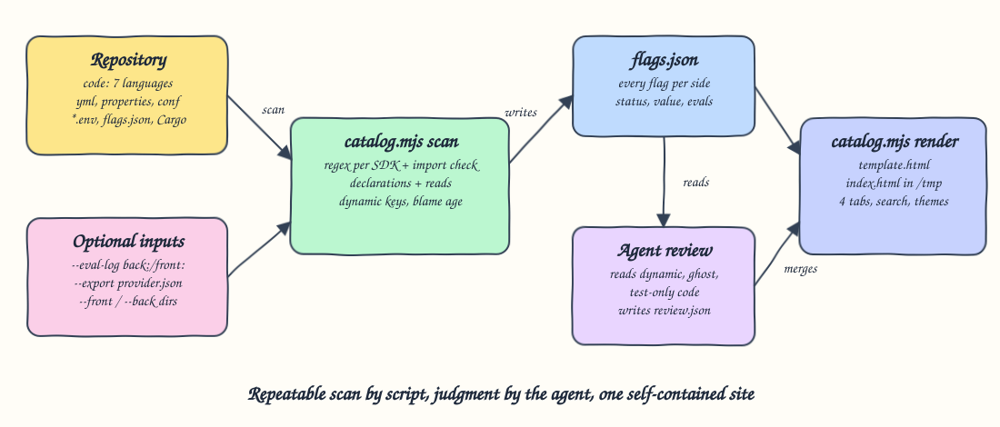
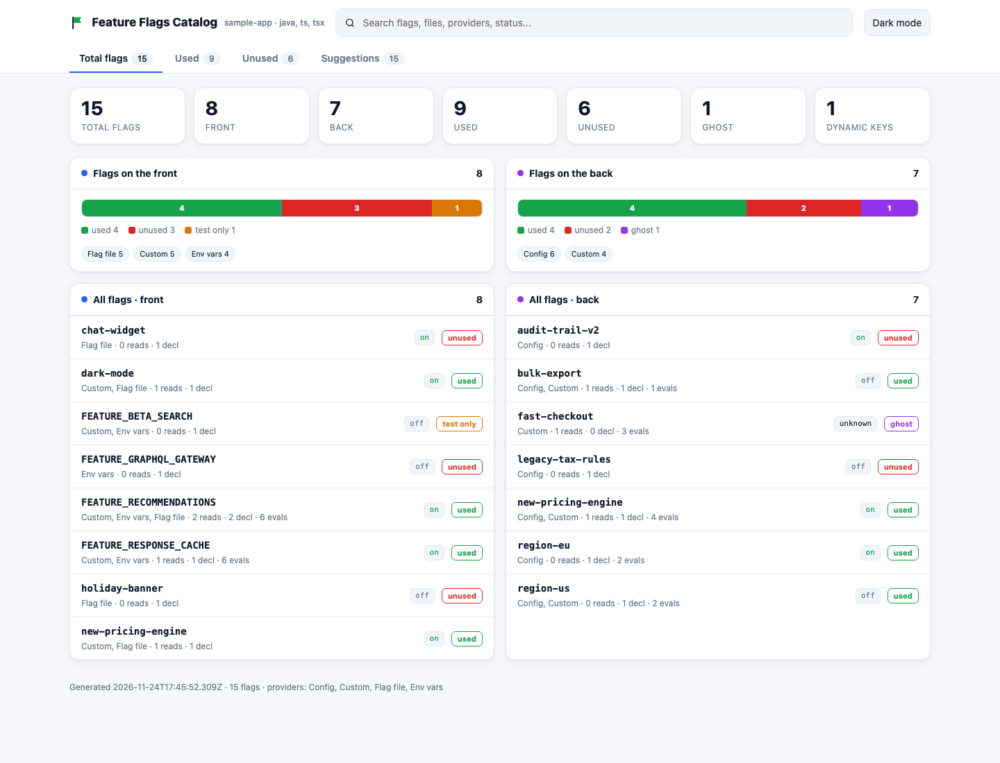
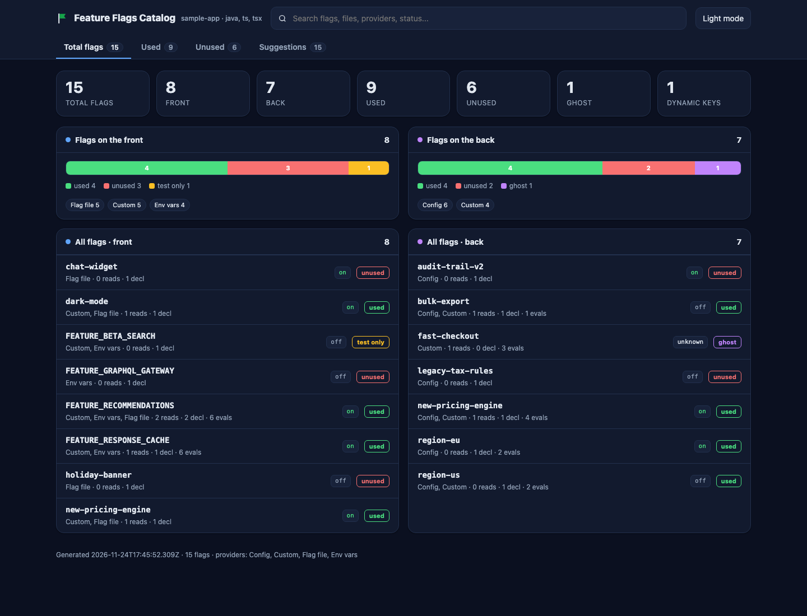
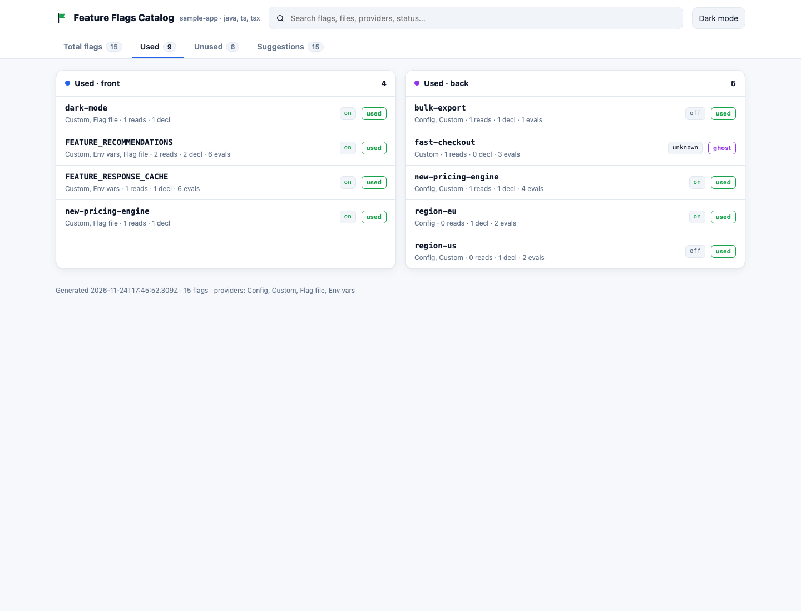
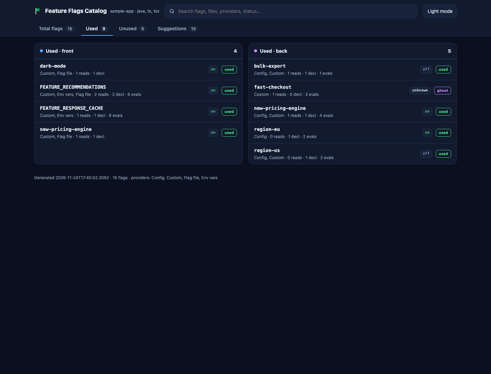
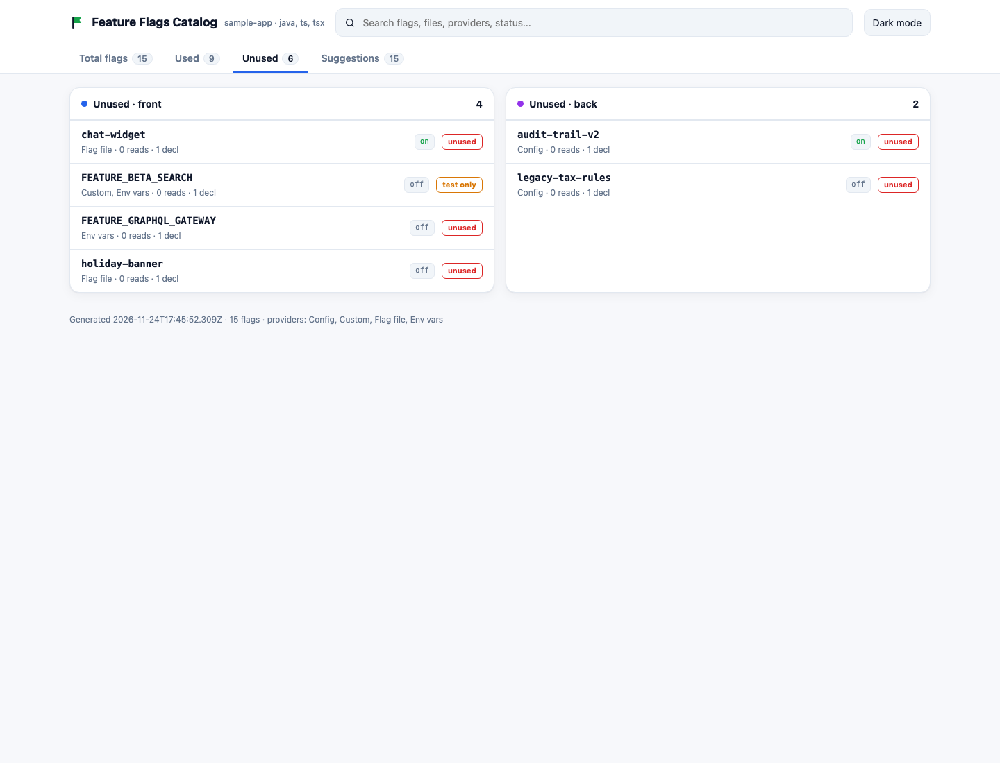
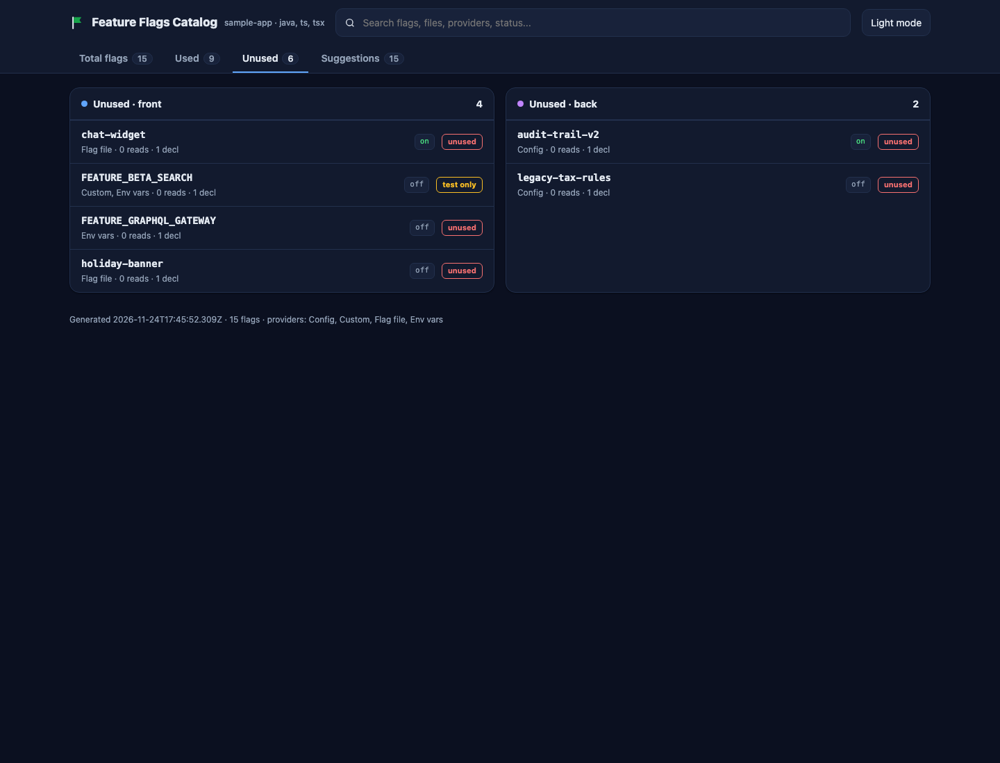
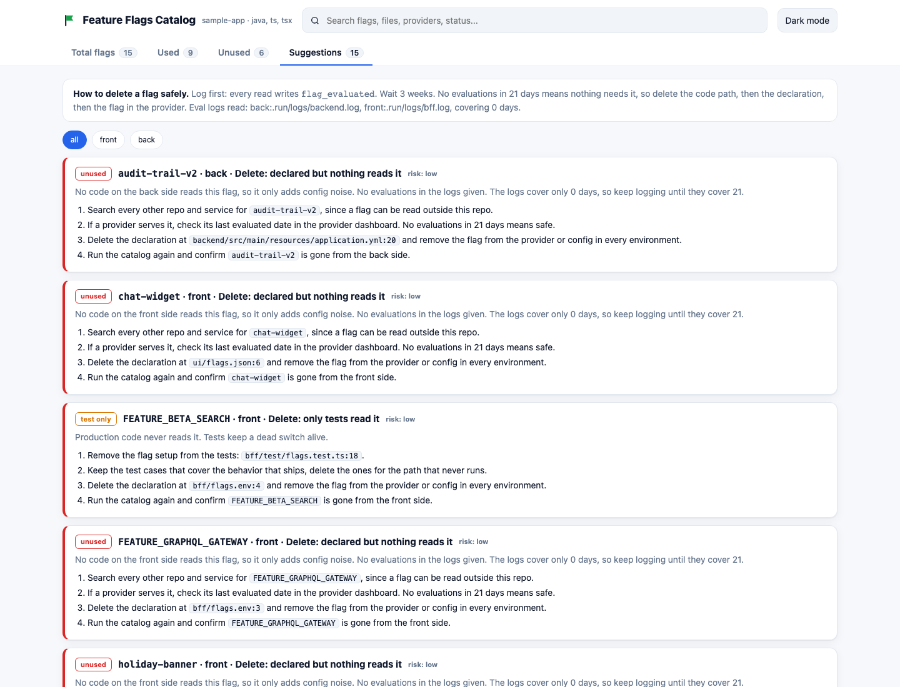
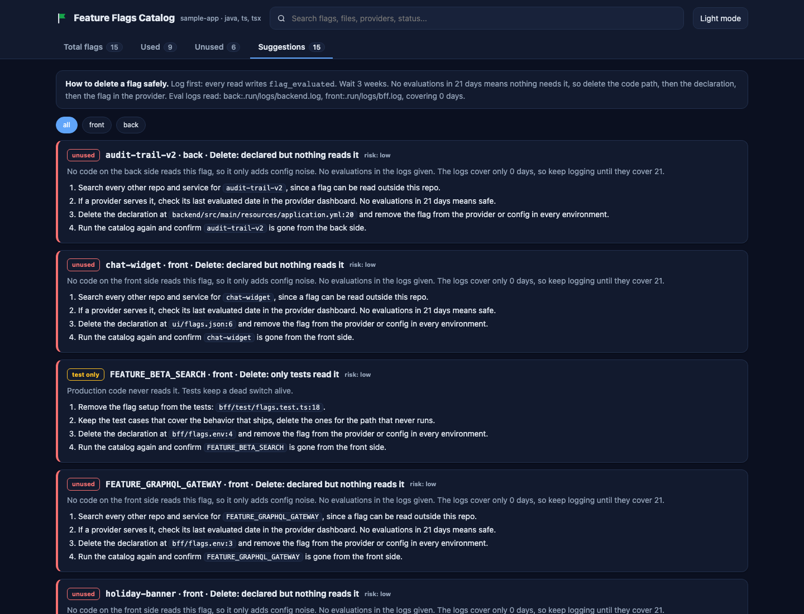
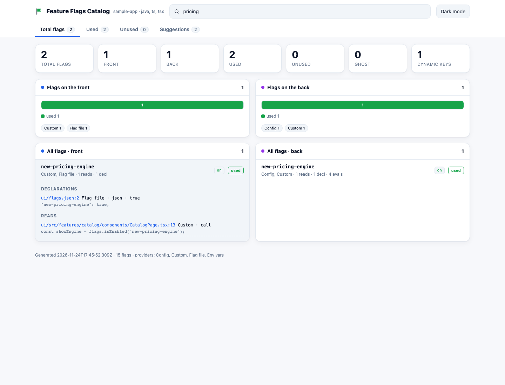

<p align="center"></p>

# feature-flags-catalog

A skill for Claude Code and Codex that finds every feature flag in a repository, splits it into front and back, separates used from unused, and renders a searchable light and dark website with a safe plan to delete each dead flag.

## How it Works

1. `scripts/catalog.mjs scan` walks the repo with zero dependencies. It reads declarations from `application.yml`, `.properties`, HOCON `.conf`, TOML, `*.env`, flag JSON files, `ff4j.xml`, Togglz enums and `Cargo.toml` features.
2. It finds reads for 18 SDKs plus config keys, env vars and `cfg(feature)`. The provider comes from the imports in the same file, so a bare `isEnabled` on a random object is not a flag read.
3. Every flag is keyed by side and a normalized name, so `FEATURE_NEW_CHECKOUT`, `new-checkout` and `newCheckout` are the same flag.
4. Dynamic keys like `"region-" + region` are listed with their prefix. A declared flag that the prefix can build is `maybe-dynamic`, never `unused`.
5. Optional `--eval-log` files add the evaluation count and the last evaluation per flag, and how many days the logs cover.
6. The agent reviews dynamic, ghost and test-only flags in the code and writes `review.json`.
7. `scripts/catalog.mjs render` merges the review into `assets/template.html` and writes one self-contained `index.html` in a temp folder.

## Architecture

<p align="center"></p>

## Features

* **Front and back split**: from folder names (`ui`, `bff`, `frontend` vs `backend`, `server`, `api`) or `--front` / `--back`, because a flag can be dead on one side and alive on the other.
* **18 SDKs detected**: LaunchDarkly, Optimizely, FF4J, Togglz, Unleash, OpenFeature, Split, Flagsmith, GrowthBook, ConfigCat, Statsig, PostHog, Flipt, DevCycle, Eppo, Harness, Firebase Remote Config, Azure App Configuration, Django Waffle. That is where real flags live.
* **Five statuses**: used, unused, ghost (read but never declared), test-only and maybe-dynamic. Each one needs a different action.
* **SaaS aware**: a flag read through a provider SDK is declared in the provider, not a ghost. `--export` reads a provider export to find SaaS flags no code reads.
* **Log first, then delete**: the suggestions follow log first, wait 3 weeks, delete the code path, the declaration, then the provider flag. "Safe now" only shows when the logs cover 21 days.
* **Constant resolution**: `static final String FLAG = "x"` and `const FlagX = "x"` are followed to the key.
* **Git age**: `git blame` on each declaration gives its age, to spot rollouts that never finished.
* **Site**: four tabs (Total flags, Used, Unused, Suggestions), one search box over every tab, a light and dark switch that is remembered, click a flag for every `file:line`.
* **Progressive disclosure**: `SKILL.md` is short. The agent reads only the language files for the languages the scan found, and the playbook only when there is something to review.

## Languages

| Language | Versions | File |
|---|---|---|
| Java | 8 to 25 | [languages/java.md](languages/java.md) |
| Kotlin | 2.x | [languages/kotlin.md](languages/kotlin.md) |
| Scala | 2 and 3 | [languages/scala.md](languages/scala.md) |
| Go | any | [languages/go.md](languages/go.md) |
| Rust | edition 2024, 1.99 | [languages/rust.md](languages/rust.md) |
| Python | 3.x | [languages/python.md](languages/python.md) |
| Node.js and Bun | JS and TS | [languages/node.md](languages/node.md) |

## Stack

* **Node.js, no dependencies**: the scanner and the renderer are one `.mjs` file, so install is a copy and the scan runs anywhere Node runs.
* **Plain HTML, CSS and JS**: the site is one file with the data inlined, so it opens from disk with no server.
* **node:test**: the scanner tests run with no test framework to install.

## Contracts

```
node scripts/catalog.mjs scan <repo> [--out dir] [--front dirs] [--back dirs] [--eval-log [front:|back:]path]... [--export file]... [--export-side front|back]
node scripts/catalog.mjs render <dir>
```

`flags.json`:

```json
{
  "root": "sample-app",
  "languages": ["java", "ts", "tsx"],
  "evalLogs": { "files": ["back:.run/logs/backend.log"], "enabled": true, "windowDays": 21, "coverageDays": 0 },
  "flags": [
    {
      "id": "back:bulkexport", "side": "back", "name": "bulk-export", "status": "used", "value": "off",
      "providers": ["Config", "Custom"], "ageDays": 0,
      "declarations": [{ "file": "backend/src/main/resources/application.yml", "line": 16, "value": false }],
      "references": [{ "file": "backend/.../ExportController.java", "line": 22, "provider": "Custom", "test": false }],
      "evaluations": { "count": 1, "last": "2026-11-24T17:45:09.000Z", "daysSinceLast": 0 }
    }
  ],
  "dynamics": [{ "file": "backend/.../PricingService.java", "line": 22, "expression": "\"region-\" + region", "prefix": "region-" }]
}
```

`review.json`, written by the agent: `[{ "side": "back", "name": "region-eu", "status": "used", "note": "closed set of regions in PricingService" }]`.

Evaluation log line, one JSON object per line: `{"event":"flag_evaluated","flag":"<name>","value":true,"time":"<iso>"}`. `message` and `@timestamp` work too.

## Design Decisions

* **Script for the scan, agent for the judgment**: regex gives the same answer on every run. The agent only settles what regex cannot, and its decisions are kept in `review.json`.
* **Provider from imports**: method names like `isEnabled` and `getValue` are everywhere. A call counts only when its SDK is imported in the file, the method is unique to one SDK, or the receiver is named like a flag holder.
* **No deletion**: the skill only reports. Deleting a flag is a product decision.
* **Report in a temp folder**: the scanned repo stays clean.

## Sample App

[sample-app/](sample-app) is a shop with a React UI, a Node BFF and a Java backend. It has used, unused, ghost, dynamic and test-only flags on both sides, so the catalog has something real to find. See [sample-app/README.md](sample-app/README.md).

## Install

```bash
./install.sh
./uninstall.sh
```

Both ask for global Claude (`~/.claude/skills`), global Codex (`~/.codex/skills`) or both. Then run `/feature-flags-catalog` in a repository.

## Tests

```bash
node --test tests/catalog.test.mjs
```

20 tests over fixtures for Java 8, Java 25, Kotlin, Scala 2, Scala 3, Go, Rust, Python and Node/Bun, plus eval logs, provider exports, review merge and HTML escaping.

## Printscreens

The report generated for the sample app.

**Total flags, light**: counters, a map per side with the status split and the providers, and every flag with its value and status.



**Total flags, dark**: the same tab with the dark theme.



**Used, light**: flags production code reads, front and back. `region-eu` and `region-us` are used through the dynamic key `"region-" + region`, confirmed by the logs.



**Used, dark**



**Unused, light**: declared flags nothing reads, plus `FEATURE_BETA_SEARCH` that only tests read.



**Unused, dark**



**Suggestions, light**: one card per flag ordered by priority, with the steps and the exact `file:line`. The logs cover 0 days, so no card claims a flag is safe yet.



**Suggestions, dark**



**Search**: `pricing` filters every tab down to `new-pricing-engine` on both sides, with the declaration and the read expanded.


