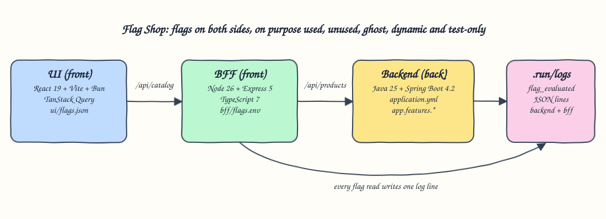
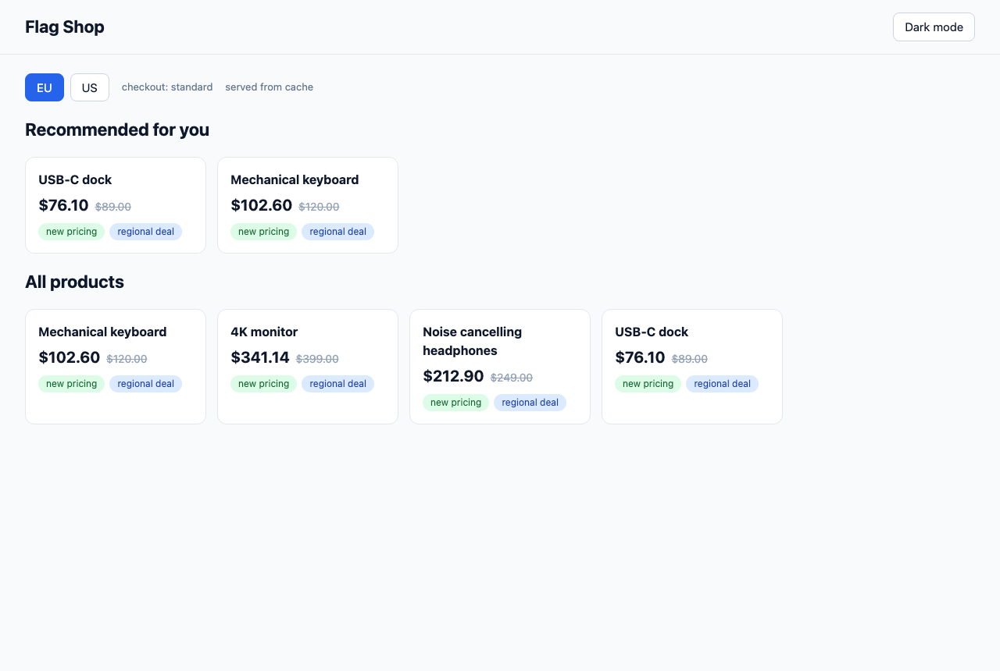
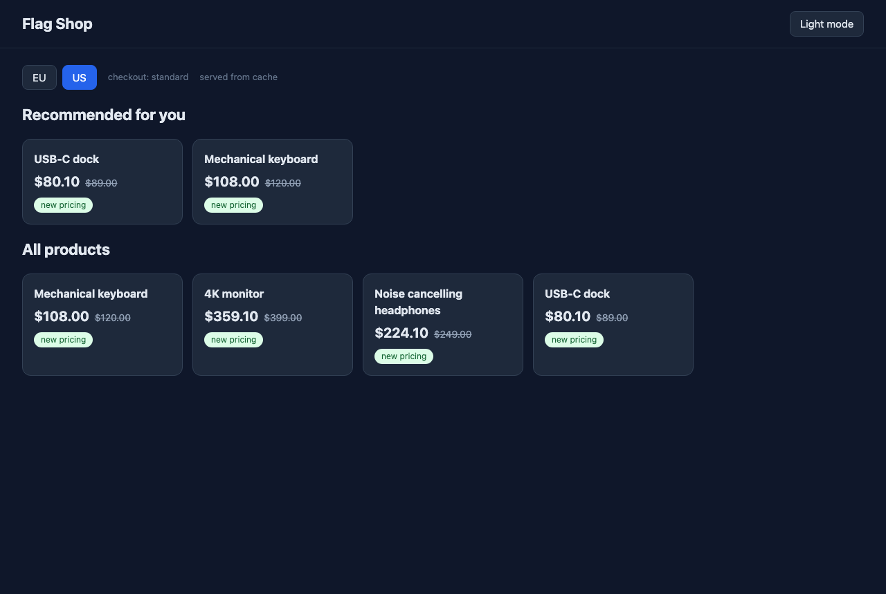

# Flag Shop

A small shop used to exercise the feature-flags-catalog skill. Flags live on both sides and cover every status the catalog reports.

## How it Works

* The UI asks the BFF for the catalog of a region. The BFF asks the backend for priced products.
* The backend reads its flags from `app.features` in `application.yml`, the BFF from `FEATURE_*` lines in `bff/flags.env`, the UI from `ui/flags.json`.
* Every flag read goes through one `FeatureFlags.isEnabled` per app and logs `flag_evaluated` with the flag and the value.
* `scripts/catalog.sh` runs the skill over this app with the backend and BFF logs as evaluation input.

## Architecture

<p align="center"></p>

## Flags

| Flag | Side | Value | Status |
|---|---|---|---|
| `new-pricing-engine` | back and front | on | used |
| `bulk-export` | back | off | used, always off |
| `region-eu`, `region-us` | back | on, off | read through `"region-" + region` |
| `fast-checkout` | back | none | ghost |
| `legacy-tax-rules`, `audit-trail-v2` | back | off, on | unused |
| `recommendations`, `response-cache` | front | on | used |
| `dark-mode` | front | on | used |
| `beta-search` | front | off | test-only |
| `graphql-gateway`, `holiday-banner`, `chat-widget` | front | off, off, on | unused |

## Features

* **New pricing engine**: 10% off every product, shown as a badge on the UI.
* **Regional deals**: 5% off in regions whose flag is on, looked up by name at runtime.
* **Recommendations**: the two cheapest products, only while the flag is on.
* **Response cache**: the BFF keeps the catalog for 30 seconds per region.
* **Bulk export**: CSV export, behind a flag that was never turned on.
* **Dark mode**: a theme switch that only shows while the flag is on.

## Stack

* **Java 25, Spring Boot 4.2.0, Maven**: backend, virtual threads, structured logstash logs.
* **Node.js 26, Express 5, TypeScript 7, npm**: BFF, runs `.ts` directly with type stripping.
* **Bun 1.4, Vite 8, React 19, TanStack Query 5, TypeScript 7**: UI.

The Java stack lists Postgres, Spring Data JDBC and HikariCP. This app has no data to store, so they are left out.

## APIs

| Service | Method | Path | Returns |
|---|---|---|---|
| backend | GET | `/api/products?region=eu` | priced products |
| backend | GET | `/api/checkout/mode` | `{"mode":"fast" \| "standard"}` |
| backend | GET | `/api/export` | CSV, or 404 problem detail while `bulk-export` is off |
| bff | GET | `/api/catalog?region=eu` | `{region, products, recommendations, cached}` |
| bff | GET | `/api/checkout/mode` | backend checkout mode |

## Tests

* Backend: unknown flags are off, the pricing engine and regional discount follow their flags.
* BFF: recommendations and cache follow their flags, env names become kebab-case, every read is logged.
* UI: a typo in a flag name is off, every read is logged.

```bash
./scripts/test-all.sh
```

## Printscreens

**EU, light**: new pricing and regional deal badges on every product, the recommendations section, and the BFF cache note.



**US, dark**: `region-us` is off so there is no regional deal, and the dark mode switch is on because `dark-mode` is on.



## Scripts

All scripts live in `scripts/` and run from any directory of the repository.

| Script | What it does |
|---|---|
| `./scripts/setup.sh` | Installs dependencies and prepares the app |
| `./scripts/start-all.sh` | Starts every service and prints the full link of each one |
| `./scripts/status.sh` | Shows every service port as UP or DOWN |
| `./scripts/test-all.sh` | Runs every test suite |
| `./scripts/ui.sh` | Opens the UI in the browser |
| `./scripts/stop-all.sh` | Stops every service |
| `./scripts/catalog.sh` | Runs the feature flags catalog on this app and opens the report |

Ports are declared in `scripts/ports.env`.

```bash
./scripts/setup.sh
./scripts/start-all.sh
./scripts/status.sh
./scripts/ui.sh
./scripts/catalog.sh
./scripts/stop-all.sh
```
