<p align="center">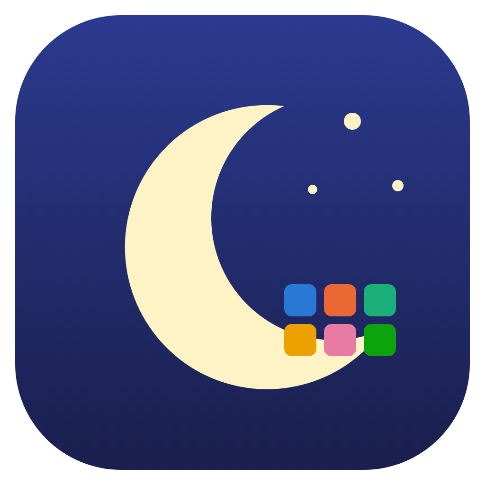</p>

# Night Agents

Eleven agent skills that work the night shift on your repositories, for Claude Code and Codex. Each one
finds a kind of problem, proves it, works on its own branch, runs the tests before and after,
and documents the work. Eight agents fix what they find. The architect, the security agent and the chief of staff only
document their findings and never change code, and the chief of staff reviews the work of all the others. A desktop app shows every night as a GitHub-style activity grid, lets you
browse every branch the agents created with syntax highlight and line numbers, searches
everything, and tracks metrics and trends.

| Logo | Agent | Alias | What it does |
|---|---|---|---|
|  | `code-digger-agent` | `digger` | Finds unused classes, methods, functions, variables, imports, files and dependencies, proves they are dead with tests, removes them |
|  | `presto-performance-agent` | `presto` | Finds missing indexes, N+1 queries, missing pagination, poor algorithms and data structures, missing caching, heavy images. Benchmarks before and after every fix |
|  | `migration-bot-agent` | `migration` | Bumps dependencies to the latest stable versions and migrates the code they break, tests green before and after |
|  | `test-automator-agent` | `tests` | Adds unit, property based, integration, stress, chaos, contract, CSS and UI tests for core logic. No duplicates, no tests of frameworks or the language |
| 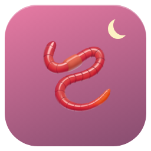 | `worm-doccer` | `docs` | Checks README, docs, performance.md, backlog.md and design-doc.md against the code and fixes the drift. The code is the source of truth |
|  | `bug-hunter` | `bugs` | Hunts bugs, writes `bug-report.md`, fixes each bug with TDD |
|  | `architect-agent` | `architect` | Reviews architecture and design: extensibility, separation of concerns, cohesion, coupling, layering and dependency direction. Documents every finding in `architecture-review.md`, never changes code |
|  | `code-review-agent` | `review` | Reviews all the code for bugs, design problems, logical fallacies, bad code, anti-patterns, broken requirements and missing tests. Fixes what a test proves, reports the rest, writes `code-review.md` |
|  | `smith-sec-agent` | `sec` | Hunts the OWASP Top 10 and zero day classes (prototype pollution, path traversal, ReDoS, races), proves each finding locally, documents it in `security-report.md`, never changes code |
|  | `test-review-agent` | `test-review` | Runs the suite 10 times to find flaky tests and fixes their cause, deletes tests of the language or the framework, rewrites tests that cannot fail, proves every kept test fails when its logic breaks, writes `test-review.md` |
|  | `chief-of-staff-agent` | `chief` | Runs last. Adversarial review of the other agents: re-checks their claims and test numbers, finds gaps, contradictions and merge conflicts between their branches, recommends a merge order in `chief-of-staff-review.md`, never changes code |

## How it Works

1. `/night-agents all` (or `/night-agents presto`, `/night-agents bugs docs`, or `/night-agents` to pick) runs inside any git repository.
2. For each agent, `night-run.sh start` creates a git worktree on a new branch `night-agents/<agent>/<date>-<time>` from the last commit, plus a run folder `~/.night-agents/runs/<date>/<project>/<agent>-<time>/`.
3. The agent installs dependencies in its worktree, runs the tests and saves the baseline log.
4. It hunts, fixes in small commits, proves each change with a test or a benchmark, and reverts anything that breaks a test. The architect and security agents commit only their findings document.
5. It runs the tests again, writes `report.md` and `result.json`, and commits the report on its branch.
6. `night-run.sh finish` validates `result.json`, refuses code changes from the report only agents, records git stats, removes the worktree, deletes empty branches and regenerates the UI.
7. In Claude Code the agents run in parallel and the chief of staff runs last, after all of them as subagents. In Codex they run one after the other.
8. Runs from every repository land in the same folder, so the UI is multi project out of the box.

Your working copy is never touched: agents only work inside their own worktrees and never push, rebase or merge.

## Architecture

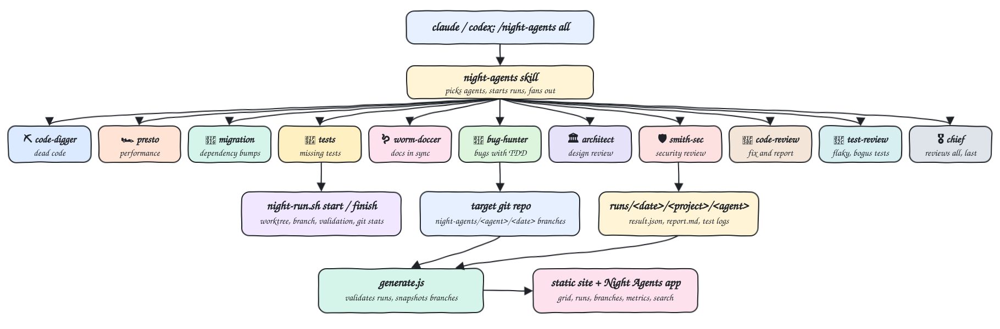

## Features

* **Eleven skills plus a dispatcher** - each agent is a plain `SKILL.md`, so the same files work in Claude Code and Codex.
* **One contract** - [`CONTRACT.md`](skills/night-agents/CONTRACT.md) gives every agent the same lifecycle, git rules and `result.json` format.
* **Worktree isolation** - agents run in parallel without touching your checkout or each other.
* **Fail loud** - `finish` refuses invalid results, regressions reported as success, and uncommitted work.
* **Durable history** - branch files and diffs are snapshotted, so history survives merged and deleted branches.
* **Activity grid** - one square per night, colored by number of runs, outlined red when a run failed, plus a per agent nightly strip.
* **Branch browser** - every agent branch, its commits and changed files, file and diff views with syntax highlight, line numbers and find in file. Markdown and HTML files open rendered, HTML in a sandbox with scripts off.
* **Agent logos** - every agent has a rounded logo in its color, generated from `agents.json` by `ui/make-logos.js`.
* **Search everything** - `⌘K` searches runs, findings, reports, commits, file names and every line of code on the agent branches.
* **Metrics and trends** - runs per week by agent, findings fixed, lines changed, passing tests over time, success by agent, trend versus the previous period.
* **Pregenerated UI** - a static site rebuilt after every run, wrapped in a macOS app with a boot screen, single instance, restored window position and the usual shortcuts.
* **Report only reviews** - the architect, security and chief of staff agents may only commit their findings document, `finish` refuses any other change.
* **Sample project** - `brew-shop`, a small API with problems planted for every agent.

## Stack

* **Bash** - `night-run.sh`, installers and ops scripts, bash 3.2 compatible for stock macOS.
* **Node.js, no dependencies** - generator, validator, highlighter, markdown renderer and SVG charts.
* **Electron** - the desktop wrapper, packaged with `@electron/packager`.
* **Git worktrees** - isolation for parallel agents.
* **node:test** - tests for the helper, the generator and the metrics.

## Contracts

### Commands

| Command | What |
|---|---|
| `/night-agents all` | run the eleven agents |
| `/night-agents digger presto` | run the named agents (names or aliases) |
| `/night-agents architect sec` | run the architecture and security reviews |
| `/night-agents review test-review chief` | review the code and the tests, then the chief of staff reviews both |
| `/night-agents` | ask which agents to run |
| `/bug-hunter`, `/worm-doccer`, ... | run one agent directly |
| Codex: `$night-agents all` or `/prompts:night-agents all` | same, in Codex |

### night-run.sh

| Call | What |
|---|---|
| `night-run.sh start <agent>` | creates branch, worktree and run folder, prints `RUN_DIR`, `WORKTREE`, `BRANCH`, `BASE_BRANCH`, `BASE_SHA`, `PROJECT`, `REPO` |
| `night-run.sh finish <run-dir>` | validates, records git stats, removes the worktree, regenerates the UI |
| `night-run.sh agents` | lists agent names |

### result.json

```json
{
  "status": "success",
  "summary": "Fixed 3 bugs with TDD, suite green.",
  "testsBefore": { "command": "npm test", "passed": 3, "failed": 0 },
  "testsAfter": { "command": "npm test", "passed": 9, "failed": 0 },
  "findings": [{ "id": "B1", "title": "Same coupon stacks twice", "kind": "logic", "file": "src/cart.js", "line": 18, "severity": "high", "action": "fixed" }],
  "metrics": { "bugsFound": 3, "bugsFixed": 3 }
}
```

`status` is `success`, `no-findings` or `failed`. For `architect-agent`, `smith-sec-agent` and `chief-of-staff-agent` every finding is `reported` and `success` means at least one finding was documented. `severity` is `low`, `medium`, `high` or `critical`. `action` is `fixed`, `reported` or `skipped`.

## Key Design Decisions

* The file system is the database: `run.json` (helper), `result.json` (agent), `git.json` (helper), `branch.json` (generator snapshot).
* The UI has no server and no port. Everything is pregenerated into `~/.night-agents/ui/` and works in the app or any browser.
* Agent colors come from a validated colorblind safe categorical palette, always paired with the agent icon and name.
* See [design-doc.md](design-doc.md) for tradeoffs and the planted problems in the sample project.

## How to Run

```bash
./scripts/setup.sh
./install.sh both
./scripts/sample.sh
cd ~/night-agents-sample/brew-shop
claude "/night-agents all"
```

Codex, headless:

```bash
codex exec -s workspace-write --add-dir ~/.night-agents -c sandbox_workspace_write.network_access=true '$night-agents all'
```

The `workspace-write` sandbox keeps `.git` read only, so Codex asks to escalate the `night-run.sh start` step that creates the branch and worktree. Approve it, or run with `-s danger-full-access` on a repo you trust.

Install the app and open it:

```bash
./ui/install.sh
./scripts/start-all.sh
```

Uninstall with `./ui/uninstall.sh` and `./uninstall.sh both` (add `--purge` to also remove every run).

## How to Test

```bash
./scripts/test-all.sh
```

## Printscreens

### Activity

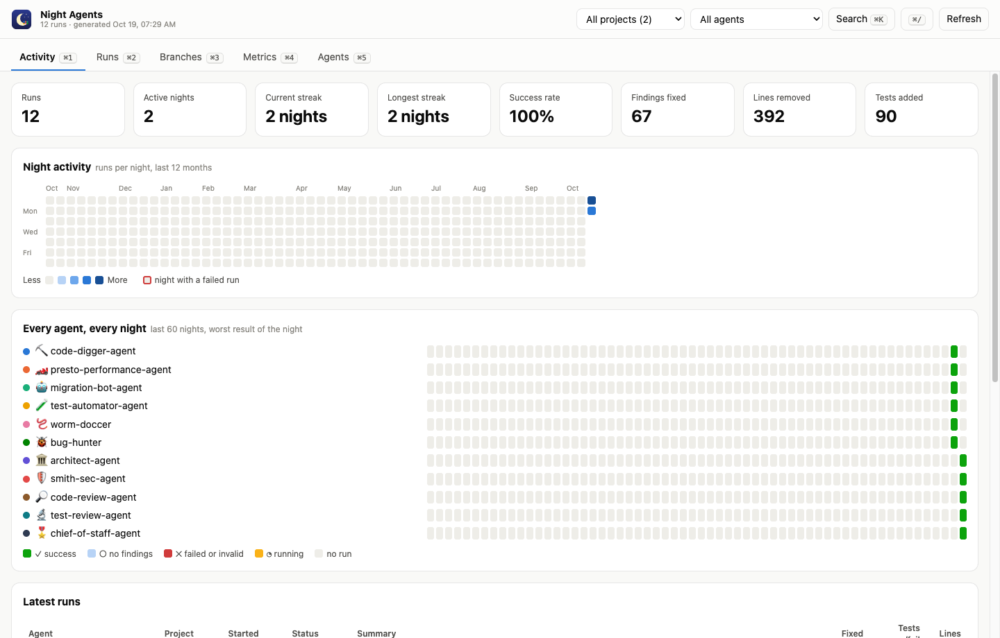

One square per night for the last 12 months. Darker blue means more runs that night, a red outline means a run failed. Below it, each agent gets a strip of the last 60 nights colored by its worst result, then the latest runs.

### Runs

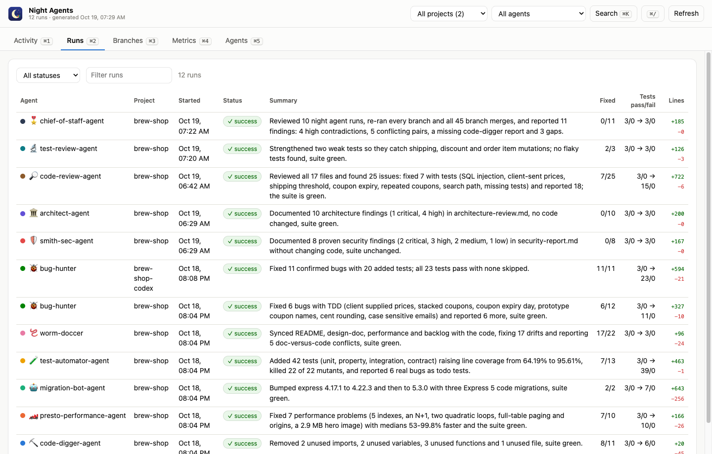

Every run with agent, project, status, summary, fixed findings, tests before and after, and lines changed. Filter by status or text, and by project and agent from the title bar.

### Run detail

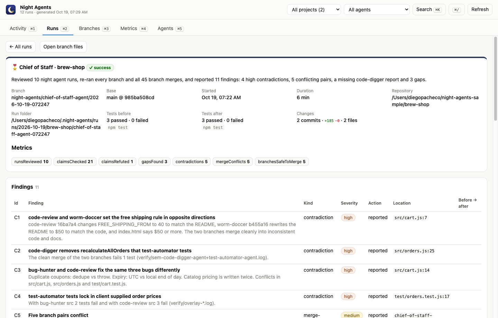

One run: branch, base commit, duration, test counts, metrics, every finding with severity and action, commits, the rendered report and the raw test logs. Clicking a finding opens its file at the line.

### Branches

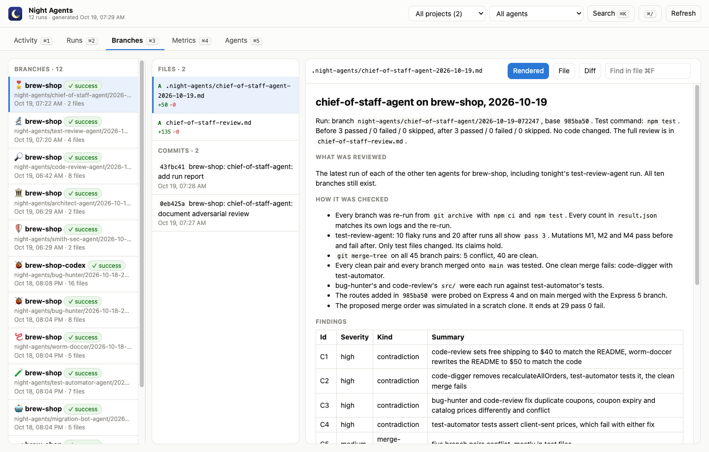

Every agent branch on the left, its changed files and commits in the middle, and the file with syntax highlight and line numbers on the right. `⌘F` finds in the file.

### Branch diff

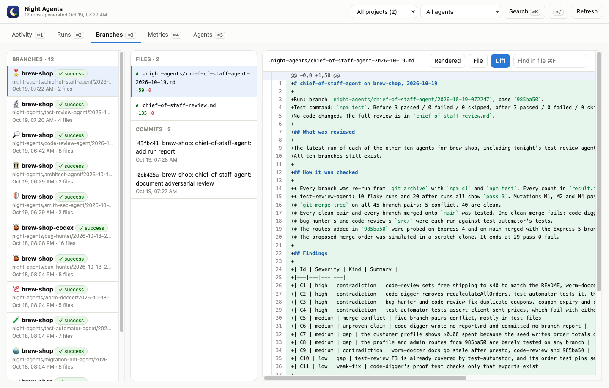

The same file as a diff against the base commit, with old and new line numbers.

### Metrics

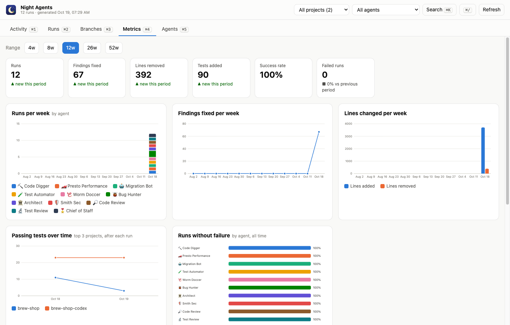

KPIs with the trend versus the previous half of the range, runs per week by agent, findings fixed, lines added and removed, passing tests over time and runs without failure by agent, plus a per agent table.

### Agents

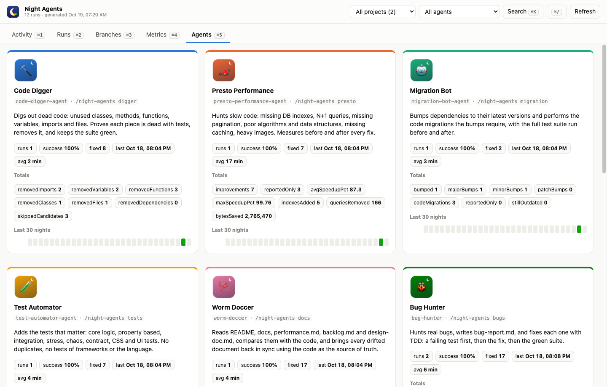

The eleven agents with logo, description, command, totals of their own metrics and their last 30 nights.

### Search

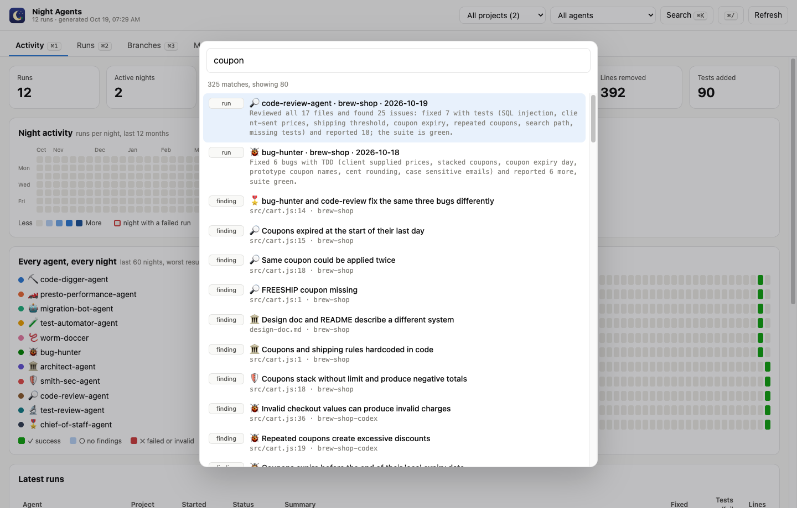

`⌘K` searches runs, findings, reports, commits, file names and code lines. Enter jumps to the run or to the file at the line.

### Shortcuts

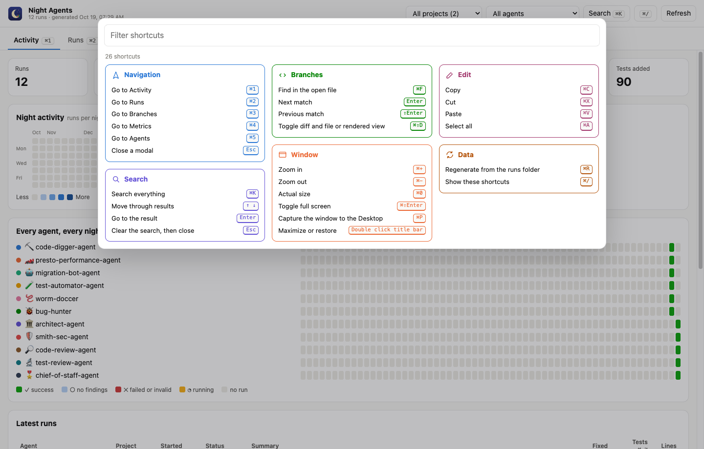

`⌘/` lists every shortcut grouped by area, with a filter on top.

## Scripts

All scripts live in `scripts/` and run from any directory of the repository.

| Script | What it does |
|---|---|
| `./scripts/setup.sh` | Installs the app and sample dependencies and builds the icon |
| `./scripts/start-all.sh` | Regenerates the UI, starts the app and prints the full link of the site and the runs folder |
| `./scripts/status.sh` | Shows core, site and app as UP or DOWN, the app pid and the run count |
| `./scripts/test-all.sh` | Runs the core tests, checks bash syntax and runs the sample tests |
| `./scripts/ui.sh` | Opens the app, or the generated site when the app is not installed |
| `./scripts/stop-all.sh` | Quits the app |
| `./scripts/sample.sh` | Creates the sample repo, `--reset` recreates it |

The app has no network service, so there is no `ports.env`.

```bash
./scripts/setup.sh
./scripts/start-all.sh
./scripts/status.sh
./scripts/ui.sh
./scripts/stop-all.sh
```
