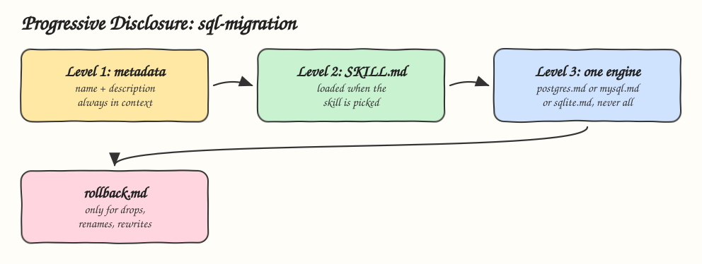

# 01 - Progressive Disclosure

Pattern: load a skill in levels so the agent pays context only for what the current step needs. Skill: `sql-migration`, which writes safe schema migrations for PostgreSQL, MySQL or SQLite.

## How it Works

1. Level 1: only the `name` and `description` frontmatter is always in context. The agent picks the skill from it.
2. Level 2: the `SKILL.md` body loads when the skill is picked. It holds the steps, not the engine details.
3. Level 3: the body tells the agent to read exactly one engine reference, the one matching the project's database.
4. `references/rollback.md` loads only when the migration drops, renames or rewrites data.
5. A PostgreSQL index migration reads two files out of five. MySQL, SQLite and rollback rules never enter the context.

## Architecture



## The Skill

| File | Level | Loaded when |
|---|---|---|
| `skill/SKILL.md` frontmatter | 1 | Always |
| `skill/SKILL.md` body | 2 | The user asks for a migration |
| `skill/references/postgres.md` | 3 | The project uses PostgreSQL |
| `skill/references/mysql.md` | 3 | The project uses MySQL or MariaDB |
| `skill/references/sqlite.md` | 3 | The project uses SQLite |
| `skill/references/rollback.md` | 3 | The change drops, renames or rewrites data |

## Install

```bash
./install.sh          # asks: 1) Claude 2) Codex 3) Both
./install.sh claude
./uninstall.sh both
```

## Use

```
write a migration that adds an index on orders.customer_id
rename users.fullname to users.display_name safely
```

## Trade-offs

* The body must say exactly when to load each reference, or the agent never reads it, or reads all of them.
* Routing depends entirely on the level 1 description. See [03 - Semantic Skill Routing](../03-semantic-skill-routing).
