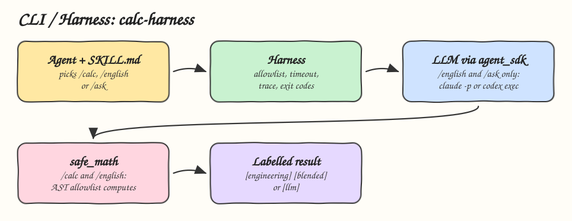

# 02 - CLI / Harness

Pattern: the skill supplies the procedure, a CLI supplies the mechanism, and a harness supplies the controls. Skill: `calc-harness`, a calculator CLI with three modes that show where code ends and the LLM begins.

## How it Works

1. `SKILL.md` tells the agent to never do arithmetic itself and which mode fits the request.
2. `/calc` is pure engineering: an AST allowlist evaluates the expression, no LLM is called.
3. `/english` is blended: the LLM only translates English into an expression, returned as JSON. The harness validates that expression with the same allowlist and computes it in code. A number the LLM computes is ignored.
4. `/ask` is pure LLM: the question needs judgement, so the model decides and the answer is labelled `[llm]`.
5. The harness refuses unknown commands, blocks code injection and huge exponents, times out LLM calls, and records every call in `/trace`.
6. LLM calls go through `agent_sdk.py`, a trimmed copy of the Python agent SDK: `claude -p` or `codex exec`.

## Architecture



## The Skill

| File | What it is |
|---|---|
| `skill/SKILL.md` | Which mode to use and the rules for reporting results |
| `skill/scripts/calc_harness.py` | The CLI: ASCII art banner, REPL, one-shot mode, the three modes, trace |
| `skill/scripts/safe_math.py` | AST allowlist evaluator: numbers, parentheses, `+ - * / // % **`, `^` as power |
| `skill/scripts/agent_sdk.py` | Claude Code and Codex runners with a timeout |
| `tests/test_calc_harness.py` | Tests with a fake LLM: no LLM in `/calc`, code computes in `/english`, injection refused |

## Run

```bash
python3 skill/scripts/calc_harness.py
```

```
   ____    _    _     ____   _   _    _    ____  _   _ _____ ____ ____
  / ___|  / \  | |   / ___| | | | |  / \  |  _ \| \ | | ____/ ___/ ___|
 | |     / _ \ | |  | |     | |_| | / _ \ | |_) |  \| |  _| \___ \___ \
 | |___ / ___ \| |__| |___  |  _  |/ ___ \|  _ <| |\  | |___ ___) |__) |
  \____/_/   \_\_____\____| |_| |_/_/   \_\_| \_\_| \_|_____|____/____/

calc> /calc (17 + 25) * 3 ^ 2
[engineering] (17 + 25) * 3 ^ 2 = 378

calc> /english fifteen percent of two hundred forty plus eight
[blended] llm parsed   : (15 * 240) / 100 + 8
code computed: 44

calc> /ask if 11 + 11 were my age, could I drive a car in Brazil?
[llm] llm decided  : YES. 11 + 11 is 22, and Brazil's minimum age for a car driver's license (category B, the CNH) is 18.
```

These are real outputs from a live run with `claude-haiku-5-5`. One-shot mode prints only the result line and exits non zero on failure:

```bash
python3 skill/scripts/calc_harness.py /calc "2 ^ 10"
python3 skill/scripts/calc_harness.py --provider codex /english seven dozen eggs split across four boxes
```

## Install

```bash
./install.sh          # asks: 1) Claude 2) Codex 3) Both
./uninstall.sh both
```

## Trade-offs

* `/english` costs one LLM call but the number is still exact, because the LLM never produces it.
* `/ask` answers are judgement, not facts. The label is the only safeguard, so the agent must keep it.
* The harness is the reliability boundary: the allowlist, not the prompt, is what stops `__import__('os')`.
