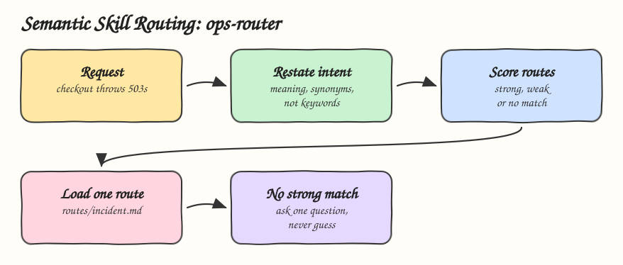

# 03 - Semantic Skill Routing

Pattern: pick the procedure from what the user means, not from an exact keyword, and refuse to guess when nothing matches. Skill: `ops-router`, which routes production operations requests to one of five runbooks.

## How it Works

1. The description lists intents and synonyms, plus what the skill is not for, so the agent picks it for "ship" and "go live" but not for "make the button blue".
2. The body restates the request as one intent and scores each route as strong, weak or no match.
3. Exactly one strong match loads one route file. The other four runbooks never enter the context.
4. Two strong matches resolve by harm: an incident beats a deploy, a rollback beats a deploy.
5. No strong match means one clarifying question, never a guess.
6. `evals/routing.md` pins requests to their expected routes. Re-check it whenever the description changes.

## Architecture



## The Skill

| File | What it is |
|---|---|
| `skill/SKILL.md` | Routes table with synonyms and the routing procedure |
| `skill/routes/deploy.md` | Deploy runbook |
| `skill/routes/rollback.md` | Rollback runbook, stops when a migration ran |
| `skill/routes/incident.md` | Incident runbook, change correlation first |
| `skill/routes/logs.md` | Log search runbook with masking |
| `skill/routes/scale.md` | Capacity runbook |
| `skill/evals/routing.md` | Requests and the route each must take |

## Install

```bash
./install.sh          # asks: 1) Claude 2) Codex 3) Both
./uninstall.sh both
```

## Use

```
checkout is throwing 503s for half the users
we deployed and now latency doubled
black friday traffic is coming, we need more pods
```

## Trade-offs

* Overlapping descriptions break routing silently. The routing evals are the only early warning.
* Asking a question costs a turn, but a confident wrong runbook in production costs more.
