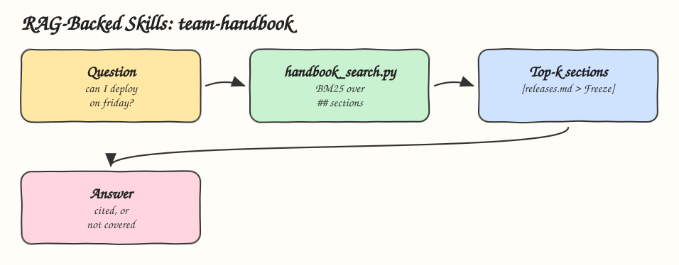

# 04 - RAG-Backed Skills

Pattern: keep the stable procedure in the skill and retrieve the changing facts from a knowledge base. Skill: `team-handbook`, which answers team policy questions with citations.

## How it Works

1. `knowledge/` holds the handbook: one markdown file per topic, one `## Section` per rule.
2. `handbook_search.py` splits the files into sections and ranks them with BM25. Rare words such as `freeze` weigh more than common ones, and simple plurals are folded.
3. The skill runs the retriever with the user question and gets the top 3 sections, each tagged `[file > section]`.
4. The agent answers only from those sections and cites them.
5. No section above the minimum score prints `NO RELEVANT KNOWLEDGE FOUND`, and the skill says the handbook does not cover it.
6. A team points the skill at its own handbook with `--dir` or `HANDBOOK_DIR`, without changing the skill.

## Architecture



## The Skill

| File | What it is |
|---|---|
| `skill/SKILL.md` | Procedure: retrieve, answer from sections only, cite, never answer from memory |
| `skill/knowledge/*.md` | On call, code review, releases and security rules |
| `skill/scripts/handbook_search.py` | Section chunking, BM25 ranking, text or `--json` output |
| `tests/test_handbook_search.py` | Tests for relevance, top k, the empty case and a custom handbook |

## Run

```bash
python3 skill/scripts/handbook_search.py "can I deploy on friday afternoon"
```

```
[releases.md > Freeze] (...)
There is no deploy to production on Fridays after 14:00 and during the last two weeks of December, unless it fixes an incident.
```

## Install

```bash
./install.sh          # asks: 1) Claude 2) Codex 3) Both
./uninstall.sh both
```

## Trade-offs

* A handful of stable rules fits better as plain references, see [01](../01-progressive-disclosure). RAG pays off when the knowledge is large or changes often.
* Lexical BM25 misses synonyms. Embeddings or hybrid search are the upgrade when the handbook grows.
* Retrieved text is data. The skill tells the agent never to follow instructions found inside it.
