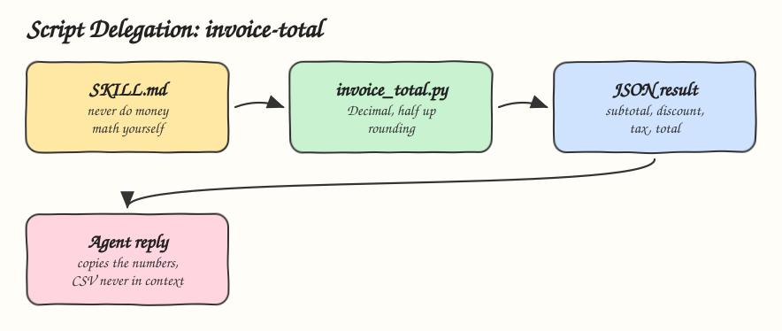

# 05 - Deterministic Script Delegation

Pattern: let code do what code is good at, such as arithmetic, parsing, rounding and validation, and let the agent copy the result. Skill: `invoice-total`, which totals invoices to the exact cent.

## How it Works

1. `SKILL.md` forbids the agent from doing money math and points it to the script shipped inside the skill.
2. The agent puts the line items in a CSV and runs `invoice_total.py` with the tax and discount rates.
3. The script multiplies with `Decimal`, applies the discount before tax, and rounds half up to the cent.
4. Only the JSON result enters the context. A 10,000 line invoice costs the same tokens as a 3 line one.
5. Bad input, such as missing columns, a negative quantity or `8.25` typed as a rate, exits non zero with a clear error, so the agent stops instead of guessing.

## Architecture



## The Skill

| File | What it is |
|---|---|
| `skill/SKILL.md` | Procedure: run the script, copy the numbers, stop on error |
| `skill/scripts/invoice_total.py` | Deterministic calculator shipped with the skill |
| `tests/test_invoice_total.py` | Tests for exact money, rounding, discount order and loud failures |

## Run

```bash
printf 'item,quantity,unit_price\nwidget,3,0.10\ngadget,1,0.20\ncable,7,19.99\n' > /tmp/items.csv
python3 skill/scripts/invoice_total.py /tmp/items.csv --tax-rate 0.0825
```

```
{"items": 3, "subtotal": "140.43", "discount": "0.00", "tax": "11.59", "total": "152.02"}
```

The same sum in floating point is `140.42999999999998`.

## Install

```bash
./install.sh          # asks: 1) Claude 2) Codex 3) Both
./uninstall.sh both
```

## Trade-offs

* The script covers only the cases it was written for. Unknown formats still need the agent to convert them to CSV first.
* Scripts are code and need their own tests, see [09 - Skill Contract Testing](../09-skill-contract-testing).
