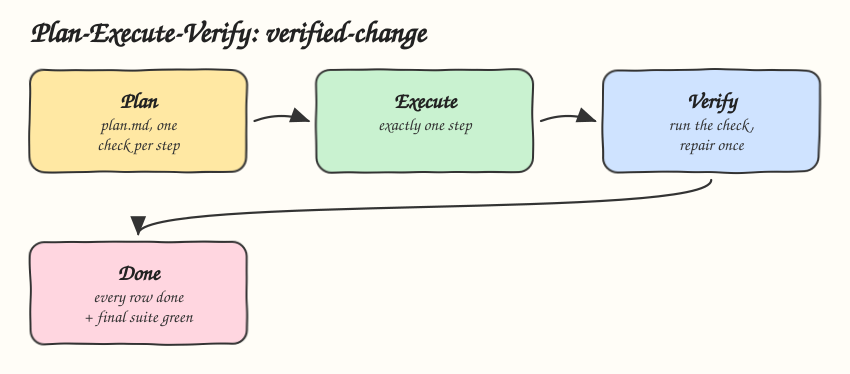

# 06 - Plan-Execute-Verify

Pattern: separate deciding, doing and proving. Every step carries the check that proves it, and the change is done only when every check passed. Skill: `verified-change`, for refactors, config migrations and dependency bumps.

## How it Works

1. Plan: the agent writes `plan.md` from the template before touching a file. Each row has a step and a check command.
2. A step without a check is not allowed. The agent splits it or finds a check.
3. Changes over 3 files wait for the user to approve the plan.
4. Execute: exactly one step, nothing outside the plan.
5. Verify: run the check of that step and read its real output. Pass marks the row `done` with the exit code. Fail gets one repair, and a second failure stops the change.
6. Done means every row is `done` and the final test suite passed. Anything else is reported as not done.

## Architecture



## The Skill

| File | What it is |
|---|---|
| `skill/SKILL.md` | The three phases and the definition of done |
| `skill/references/plan-template.md` | `plan.md` table: step, check, status, evidence |

## Install

```bash
./install.sh          # asks: 1) Claude 2) Codex 3) Both
./uninstall.sh both
```

## Use

```
rename the timeout setting to timeout_ms and convert it to milliseconds everywhere
bump jackson to the latest version and fix what breaks
```

## Trade-offs

* Writing a check per step costs time up front. It is the time a reviewer would spend later.
* The skill can only ask for checks. For runtime enforcement of "no done without a passing check", pair it with [08 - Evidence-Carrying Skills](../08-evidence-carrying-skills).
