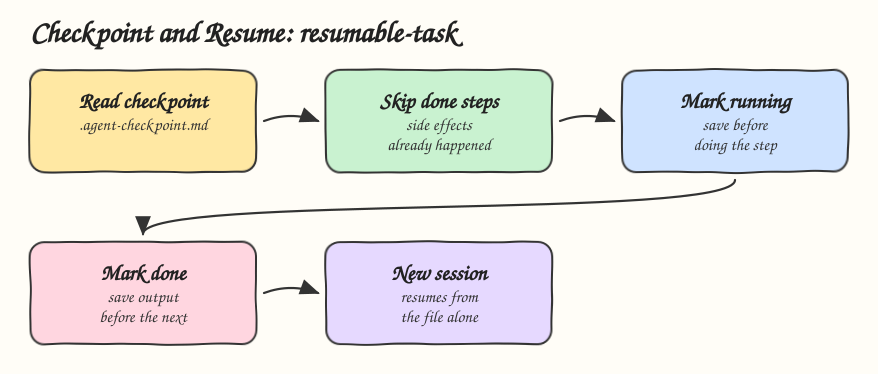

# 07 - Checkpoint and Resume

Pattern: persist workflow state after every step so a crashed, timed out or new session continues where the last one stopped, without redoing work that had side effects. Skill: `resumable-task`, for backfills, bulk renames and long refactors.

## How it Works

1. State lives in `.agent-checkpoint.md` in the working directory, not in the conversation.
2. On start the agent reads the file. If it exists, it resumes at the first step that is not `done`.
3. Before a step the row is marked `running` and saved. After it, the row is marked `done` with its output and saved before the next step starts.
4. A row found as `running` crashed midway. The agent checks what it changed before running it again.
5. Later steps read earlier outputs from the file, so a new session with no memory still has them.
6. The file is deleted only after every step is done and the user saw the summary.

## Architecture



## The Skill

| File | What it is |
|---|---|
| `skill/SKILL.md` | Start or resume, per step saving, crash rules |
| `skill/references/checkpoint-template.md` | Checkpoint table with `todo`, `running`, `done`, `failed` |

## Install

```bash
./install.sh          # asks: 1) Claude 2) Codex 3) Both
./uninstall.sh both
```

## Use

```
export all 150,000 users to csv in batches of 50,000
rename the package com.acme.billing to com.acme.payments across the repo
continue the task from the checkpoint
```

## Trade-offs

* Saving after every step costs a write per step, which is cheap next to redoing a backfill.
* A step that dies halfway through a side effect may run twice, so steps must be idempotent: upserts, `mkdir -p`, skip what is already renamed.
* A file checkpoint fits one machine. Shared, long running jobs belong in a workflow engine.
