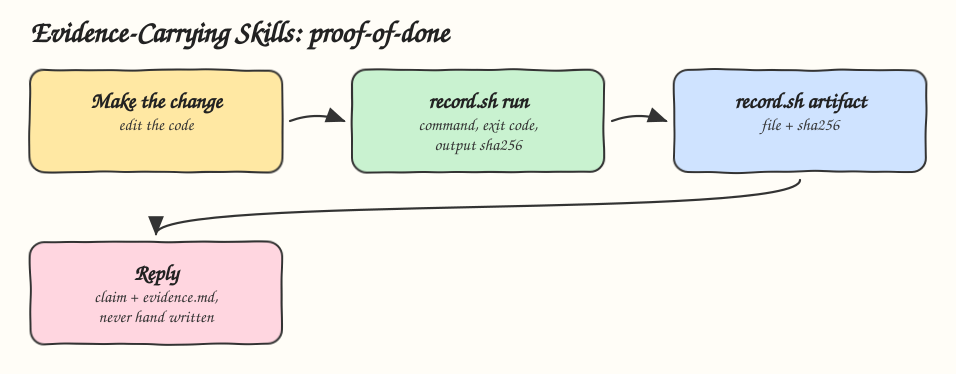

# 08 - Evidence-Carrying Skills

Pattern: a skill returns proof with its claim, meaning the checks it ran with their exit codes and output hashes, and the files it produced with their hashes. Skill: `proof-of-done`, which makes "done" mean verified.

## How it Works

1. The agent makes the change.
2. Every check runs through `record.sh run evidence.md -- <command>`. The recorder runs the command, passes its output and exit code through, and appends the command, exit code, sha256 of the output and the last 20 lines to `evidence.md`.
3. Every produced file is attached with `record.sh artifact evidence.md <file>`, which writes its sha256.
4. The reply carries the claim, the path to `evidence.md` and each check with its exit code.
5. Any non zero exit code means not done. The skill forbids editing `evidence.md` by hand, so an exit code cannot be invented.
6. A file changed after it was attached has a stale hash and must be attached again.

## Architecture



## The Skill

| File | What it is |
|---|---|
| `skill/SKILL.md` | Procedure and the rules for what counts as done |
| `skill/scripts/record.sh` | Recorder for checks and artifacts, bash only, `sha256sum` or `shasum` |
| `tests/test_record.py` | Tests for real exit codes, output hashes, stale artifacts and bad usage |

## Run

```bash
skill/scripts/record.sh run evidence.md -- python3 -c "print('tests ok')"
skill/scripts/record.sh artifact evidence.md skill/SKILL.md
```

````
## check 2026-10-27T03:53:12Z

- command: `python3 -c print('tests ok')`
- exit code: 0
- output sha256: 93d93de8c7217bf933ebbd9ecbc30e5ffeda61a1aed8b4af97d706cbece43c47

```
tests ok
```
````

## Install

```bash
./install.sh          # asks: 1) Claude 2) Codex 3) Both
./uninstall.sh both
```

## Trade-offs

* Evidence proves the checks ran, not that the checks are good. Pair it with [09 - Skill Contract Testing](../09-skill-contract-testing).
* The rule against hand edits is an instruction. A harness that owns `evidence.md` would turn it into enforcement.
