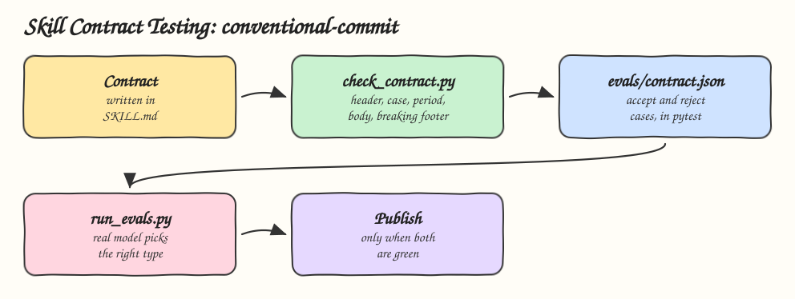

# 09 - Skill Contract Testing

Pattern: write the skill's contract down, then test both the deterministic part and the model's behavior against it before the skill ships. Skill: `conventional-commit`, which writes commit messages in the Conventional Commits format.

## How it Works

1. `SKILL.md` states the contract in plain words: header shape, type list, 72 character header, lowercase subject, no trailing period, blank line before the body, `BREAKING CHANGE:` footer for `!`.
2. `check_contract.py` enforces the same contract in code. The skill pipes every message through it and fixes violations before committing.
3. `evals/contract.json` holds messages the checker must accept or reject, each with the reason. pytest runs every case.
4. `evals/behavior.json` holds changes and the commit type the skill must pick. `run_evals.py` sends the real `SKILL.md` plus each change to a real model and checks the reply against the contract and the expected type.
5. Any change to the skill, the contract or the checker must keep both suites green before it is published.

## Architecture



## The Skill

| File | What it is |
|---|---|
| `skill/SKILL.md` | Procedure and the written contract |
| `skill/scripts/check_contract.py` | Contract checker, reads the message from stdin, exit 1 with each violation |
| `skill/scripts/run_evals.py` | Behavior evals against `claude -p` or `codex exec` |
| `skill/evals/contract.json` | 10 accept and reject cases for the checker |
| `skill/evals/behavior.json` | 4 changes with the expected commit type |
| `tests/test_contract.py` | Runs the contract cases and tests the eval runner with a fake model |

## What the contract caught

The first live run with Claude passed 3 of 4 cases. On the refactor case the model wrote body lines longer than 100 characters, even though the contract was in the skill:

```
FAIL refactor: refactor(billing): move rounding helpers from invoice to money
     body line 3 is longer than 100
     body line 5 is longer than 100
3/4 cases passed with claude claude-haiku-5-5
4/4 cases passed with codex gpt-5.6-luna
```

The fix went into the skill, not the checker: step 3 now says to hard wrap the body at 72 characters. The rerun passed:

```
4/4 cases passed with claude claude-haiku-5-5
```

## Run

```bash
printf 'fix: Reject tokens.' | python3 skill/scripts/check_contract.py
python3 skill/scripts/run_evals.py --provider claude
python3 skill/scripts/run_evals.py --provider codex
```

## Install

```bash
./install.sh          # asks: 1) Claude 2) Codex 3) Both
./uninstall.sh both
```

## Trade-offs

* The contract only covers what the cases cover. Add a case for every bug found.
* Behavior evals call a real model, so they cost tokens and can flake. They run on demand, not on every commit.
