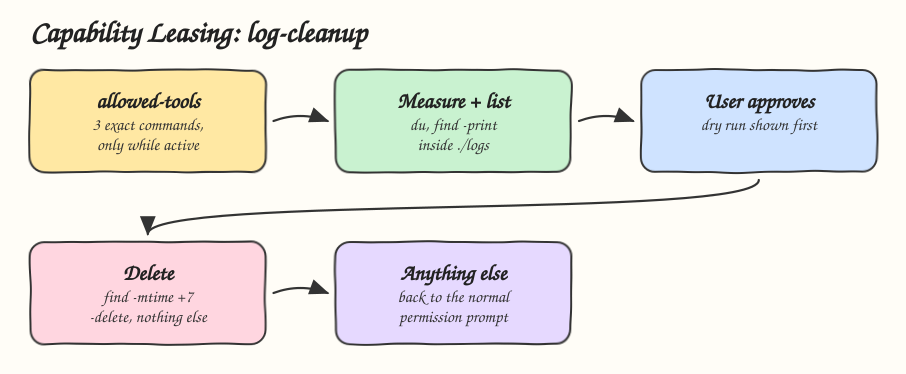

# 10 - Least-Privilege Capability Leasing

Pattern: a skill gets the smallest set of capabilities its job needs, only while it is active, and everything else stays behind the normal permission gate. Skill: `log-cleanup`, which deletes rotated logs older than 7 days in `./logs`.

## How it Works

1. The `allowed-tools` frontmatter leases exactly three commands: measure with `du`, list with `find -print`, delete with `find -delete`, all scoped to `./logs`, `*.log.*` and `-mtime +7`.
2. Claude Code pre-approves only those exact commands while the skill is active. Any other command, path or flag goes back to the normal permission prompt.
3. The body still runs a dry run first: measure, list, then ask the user before deleting.
4. Active logs (`*.log`) never match the lease, only rotated ones (`*.log.1`, `*.log.2.gz`).
5. The skill forbids widening the lease, so no `rm -rf`, no `sudo` and no other path.

## Architecture



## The Skill

| File | What it is |
|---|---|
| `skill/SKILL.md` | `allowed-tools` lease, the lease table, steps and rules |

## Install

```bash
./install.sh          # asks: 1) Claude 2) Codex 3) Both
./uninstall.sh both
```

## Use

```
the disk is full, clean up old logs
```

## Trade-offs

* `allowed-tools` is a Claude Code feature. Codex ignores it and falls back to its own sandbox and approval policy, so there the lease is only an instruction.
* The lease pre-approves exact command strings. A command written differently is not in the lease and will prompt, which is safe but can surprise.
* A lease limits damage, it does not judge intent. Irreversible actions still need the human approval step.
