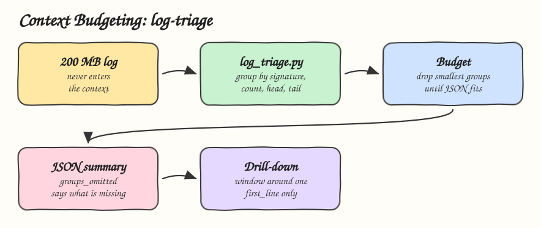

# 11 - Context Budgeting and Compression

Pattern: give every part of the work an explicit token budget and compress large inputs into a summary that fits it, so a 200 MB file costs the same context as a 2 KB one. Skill: `log-triage`, which triages a large log inside a fixed budget.

## How it Works

1. `SKILL.md` sets three budget slots: 4000 characters for the first summary, 2000 for each drill-down, 12000 for the whole triage.
2. `log_triage.py` streams the log line by line, so the file never enters the context.
3. Every error and warning is reduced to a signature: numbers, hex values and UUIDs become placeholders, so `timeout after 30s for order 123` and `timeout after 45s for order 999` are one group.
4. The summary holds the level counts, the groups ranked by count with the first line number, and the first and last 5 lines.
5. While the JSON is over budget, the smallest groups are dropped and `groups_omitted` counts them, so a partial summary always says it is partial.
6. A budget that cannot hold even the counts fails loudly instead of returning an empty summary.
7. The agent drills into one group by reading only a window around its `first_line`.

## Architecture



## The Skill

| File | What it is |
|---|---|
| `skill/SKILL.md` | Budget slots, steps and rules |
| `skill/scripts/log_triage.py` | Streaming compressor that fits its JSON into the budget |
| `tests/test_log_triage.py` | Budget is respected on a 5 MB log, grouping, omitted groups, loud failure |

## Run

```bash
python3 skill/scripts/log_triage.py /var/log/app.log --budget 4000
```

```
{"lines": 200001, "levels": {"INFO": 200000, "ERROR": 1}, "groups": [{"signature": "<n>-<n>-<n> ERROR db down", "count": 1, "first_line": 200001}], "groups_omitted": 0, "head": [...], "tail": [...]}
```

## Install

```bash
./install.sh          # asks: 1) Claude 2) Codex 3) Both
./uninstall.sh both
```

## Use

```
why did the checkout service crash last night? the log is logs/checkout.log
```

## Trade-offs

* Signatures are regex based. Two different errors that differ only in a number collapse into one group.
* The budget counts characters, not tokens. It is a stable, cheap proxy, roughly 4 characters per token for English logs.
* Compression loses detail by design. The drill-down step is how the agent gets it back, one window at a time.
