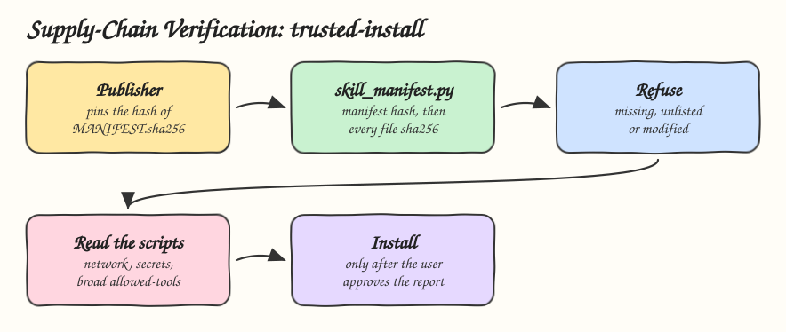

# 12 - Skill Supply-Chain Verification

Pattern: a skill is code that runs with the user's permissions, so verify its provenance and integrity before it is installed. Skill: `trusted-install`, which installs a third-party skill only when every file matches a manifest pinned by the publisher.

## How it Works

1. The publisher runs `skill_manifest.py create` to write `MANIFEST.sha256`, one sha256 per file, and publishes the hash of that manifest somewhere other than the skill: a release page, a signed tag.
2. Before installing, `skill_manifest.py verify --expect <hash>` checks the manifest against the pinned hash first, then every file against the manifest.
3. A `modified`, `missing` or `unlisted` file refuses the install. Unlisted matters: a dropped-in `postinstall.sh` leaves every listed file intact.
4. Regenerating the manifest after tampering passes the file check but no longer matches the pinned hash, so it is still refused.
5. The agent then reads every script and every `allowed-tools` line and reports network calls, credential reads and broad Bash access before the user approves.
6. This pattern's own `install.sh` verifies its own `skill/MANIFEST.sha256` in bash before copying anything.

## Architecture



## The Skill

| File | What it is |
|---|---|
| `skill/SKILL.md` | Verify, read, report, approve, install |
| `skill/scripts/skill_manifest.py` | `create` and `verify --expect` |
| `skill/MANIFEST.sha256` | This skill's own manifest, checked by `install.sh` |
| `tests/test_skill_manifest.py` | Modified, unlisted and re-manifested skills are refused, the installer refuses a tampered copy |

## Run

```bash
python3 skill/scripts/skill_manifest.py create ./my-skill
python3 skill/scripts/skill_manifest.py verify ./downloaded-skill --expect <publisher-hash>
```

```
modified: scripts/run.py
unlisted: scripts/postinstall.sh
refusing ./downloaded-skill: 2 integrity problem(s)
```

After any change to a file under `skill/`, run `python3 skill/scripts/skill_manifest.py create skill`, or `install.sh` refuses to install.

## Install

```bash
./install.sh          # verifies skill/MANIFEST.sha256, then asks: 1) Claude 2) Codex 3) Both
./uninstall.sh both
```

## Use

```
install the pdf-tools skill from ./downloads/pdf-tools, the publisher hash is 4c1e...
```

## Trade-offs

* A hash proves the files are the ones the publisher listed, not that the publisher is honest. Reading the scripts is still a step.
* The pinned hash is only as trusted as the channel it came from. A manifest hash shipped inside the same zip proves nothing.
* Signing with a key, such as Sigstore or minisign, adds identity on top of integrity. It needs a key infrastructure this pattern leaves out.
