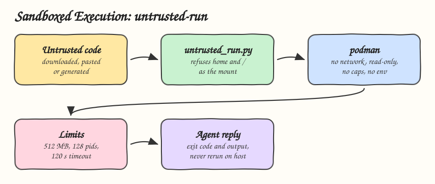

# 13 - Sandboxed Execution

Pattern: run code the agent did not write inside an isolated environment with no network, no credentials and a read-only view of one folder. Skill: `untrusted-run`, which runs a script inside podman.

## How it Works

1. `SKILL.md` forbids running untrusted code on the host and points to `untrusted_run.py`.
2. The script refuses to mount `/`, the home folder or any folder above it, because those expose SSH keys and cloud tokens.
3. It starts a podman container with `--network none`, a read-only root, the one folder mounted read-only at `/work`, `--cap-drop all`, `no-new-privileges`, 512 MB memory and 128 processes.
4. podman does not pass the host environment, so `AWS_SECRET_ACCESS_KEY` and friends are not there.
5. A timeout kills the container and returns exit code 124.
6. If the code fails because it needed the network, a write or a secret, the agent reports that instead of rerunning on the host.

## Architecture



## The Skill

| File | What it is |
|---|---|
| `skill/SKILL.md` | Sandbox table, steps and rules |
| `skill/scripts/untrusted_run.py` | Builds and runs the podman command, refuses unsafe mounts |
| `tests/test_untrusted_run.py` | Isolation flags, unsafe mounts, and live podman runs: no network, no writes, no host secrets |

## Run

```bash
python3 skill/scripts/untrusted_run.py ./job -- python /work/script.py
python3 skill/scripts/untrusted_run.py ./job --image docker.io/library/node:24-alpine -- node /work/index.js
```

```
OSError: [Errno 30] Read-only file system: '/work/data.txt'
urllib.error.URLError: <urlopen error [Errno 101] Network unreachable>
```

## Install

```bash
./install.sh          # asks: 1) Claude 2) Codex 3) Both
./uninstall.sh both
```

Needs podman. On macOS the podman machine must be running.

## Use

```
run this script from the issue and tell me what it prints, I do not trust it
```

## Trade-offs

* A container shares the host kernel. For hostile code, a micro VM such as Firecracker or gVisor is a stronger boundary.
* No network means no `pip install` inside the sandbox. Bake dependencies into the image instead.
* The first run pulls the image, which needs the network on the host.
