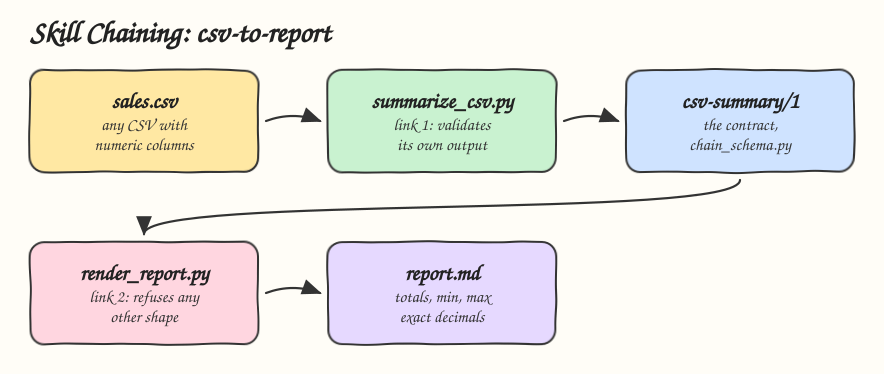

# 14 - Skill Chaining

Pattern: connect skills so the output of one is the input of the next, with a fixed schema as the contract between them and a validator at both ends of each link. Skill: `csv-to-report`, a two link chain from a CSV to a markdown report.

## How it Works

1. Link 1, `summarize_csv.py`, reads the CSV and writes JSON in the `csv-summary/1` schema: `schema`, `source`, `rows`, and per numeric column `sum`, `min`, `max` as decimal strings.
2. `chain_schema.py` is the contract in code. Link 1 validates its own output before printing it.
3. Link 2, `render_report.py`, validates the input again and refuses any other shape: a different version, extra keys, a float instead of a string, a string instead of an integer.
4. A failed link stops the chain. Link 2 never renders an error message as if it were a report.
5. A new shape is a new version, `csv-summary/2`, with its own validator, so old links never receive data they do not understand.

## Architecture



## The Skill

| File | What it is |
|---|---|
| `skill/SKILL.md` | The schema, the two links and the rules |
| `skill/scripts/chain_schema.py` | The contract shared by both links |
| `skill/scripts/summarize_csv.py` | Link 1: CSV to `csv-summary/1` |
| `skill/scripts/render_report.py` | Link 2: `csv-summary/1` to markdown |
| `tests/test_chain.py` | End to end chain, exact decimals, every rejected shape, a broken handoff |

## Run

```bash
printf 'region,amount,units\nnorth,10.00,1\nsouth,30.25,4\neast,20.25,2\n' > /tmp/sales.csv
python3 skill/scripts/summarize_csv.py /tmp/sales.csv | python3 skill/scripts/render_report.py
```

```
# Report for sales.csv

Rows: 3

| Column | Sum | Min | Max |
|---|---|---|---|
| amount | 60.50 | 10.00 | 30.25 |
| units | 7 | 1 | 4 |
```

## Install

```bash
./install.sh          # asks: 1) Claude 2) Codex 3) Both
./uninstall.sh both
```

## Use

```
give me a report with the totals of sales.csv
```

## Trade-offs

* The two links ship in one skill to keep the pattern self contained. In a real registry they are separate skills that share only the schema file.
* A hand written validator is small and has no dependencies. JSON Schema gives the same check with a library and a standard format.
* Strict schemas break on purpose. Every change to the shape is a version bump and a new link.
