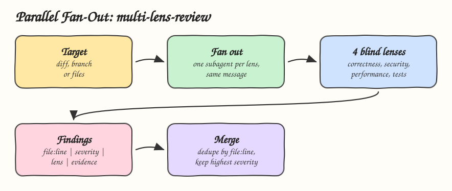

# 15 - Parallel Skill Fan-Out

Pattern: split independent work across parallel subagents, each with its own narrow brief and no view of the others, then merge their results in one deterministic step. Skill: `multi-lens-review`, which reviews a change through four blind lenses.

## How it Works

1. `SKILL.md` starts one subagent per lens in the same message, so they run at the same time: correctness, security, performance and tests.
2. Each subagent gets the same target plus only its own brief from `references/`. No lens sees another lens's findings, so none anchors on the first problem found.
3. Every lens answers in one fixed line format, `file:line | severity | lens | finding | evidence`, or `none`.
4. The merge drops lines without a location or evidence, groups lines by `file:line`, keeps the highest severity and joins the lenses that found it.
5. A lens that fails is reported as not reviewed, never filled in by the merger.

## Architecture



## The Skill

| File | What it is |
|---|---|
| `skill/SKILL.md` | Fan out, answer format, merge and rules |
| `skill/references/correctness.md` | Correctness lens brief |
| `skill/references/security.md` | Security lens brief |
| `skill/references/performance.md` | Performance lens brief |
| `skill/references/tests.md` | Tests lens brief |

## Install

```bash
./install.sh          # asks: 1) Claude 2) Codex 3) Both
./uninstall.sh both
```

## Use

```
review my branch against main from every angle
```

## Trade-offs

* Four subagents cost about four reviews in tokens. Wall clock time stays close to one review.
* The same bug on two different lines is two findings. Deduplication by location is simple and predictable, not semantic.
* Without subagents, as in some runtimes, the lenses run as sequential passes and the blindness depends on starting each pass fresh.
