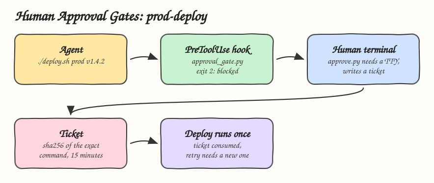

# 16 - Human Approval Gates

Pattern: sensitive or irreversible actions need an explicit human approval that the runtime enforces, not a promise in the prompt. Skill: `prod-deploy`, where a PreToolUse hook blocks every production deploy until a human approves that exact command.

## How it Works

1. `approval_gate.py` runs as a Claude Code PreToolUse hook before every Bash, Write and Edit call.
2. It guards `deploy.sh prod`, `kubectl ... --context prod` and `terraform apply`. Anything else passes.
3. A guarded command without a ticket exits 2. Claude Code blocks the call and shows the agent the message, including the approve command for the human.
4. The human runs `approve.py '<command>'` in their own terminal. It refuses without a TTY, so the agent cannot run it through a pipe, and it writes a ticket named after the sha256 of the exact command.
5. The next identical command passes once and the ticket is deleted. A different version, a changed flag or a retry needs a new approval. Tickets expire after 15 minutes.
6. The hook also blocks the agent from running `approve.py` or writing into `.approvals/` with Bash or the file tools.

## Architecture



## The Skill

| File | What it is |
|---|---|
| `skill/SKILL.md` | Staging first, show the exact command, ask, run once |
| `skill/scripts/approval_gate.py` | PreToolUse hook, exit 2 blocks |
| `skill/scripts/approve.py` | Human only approval, needs a TTY |
| `skill/hooks.json` | Hook registration to merge into `~/.claude/settings.json` |
| `tests/test_approval_gate.py` | Blocked without approval, once per approval, exact command, expiry, self approval refused |

## Verified in a real session

Running `claude -p` with the hook in `--settings`, asking it to run `./deploy.sh prod v1`:

```
PreToolUse:Bash hook error: [...approval_gate.py]: blocked: `./deploy.sh prod v1` needs human approval. Ask the user to run in their own terminal, in this folder:
python3 "$HOME/.claude/skills/prod-deploy/scripts/approve.py" './deploy.sh prod v1'
```

Nothing was deployed. After the approval, the same prompt deployed once and the ticket was consumed.

## Install

```bash
./install.sh          # asks: 1) Claude 2) Codex 3) Both
./uninstall.sh both
```

Then merge `skill/hooks.json` into the `hooks` of `~/.claude/settings.json`. The installer does not edit settings. The skill without the hook is only an instruction.

## Use

```
deploy v1.4.2 to staging, then to prod
```

## Trade-offs

* Hooks are a Claude Code feature. In Codex the gate is only the instruction, use its approval policy for the real gate.
* The guard is a regex. A deploy called through an alias or a wrapper script it does not know passes. Add those to `GUARDED`.
* The agent shares the filesystem with the tickets. Blocking `.approvals` in commands is a speed bump against an obfuscated write, not a wall. For real separation, keep approvals in a service the agent cannot write to.
