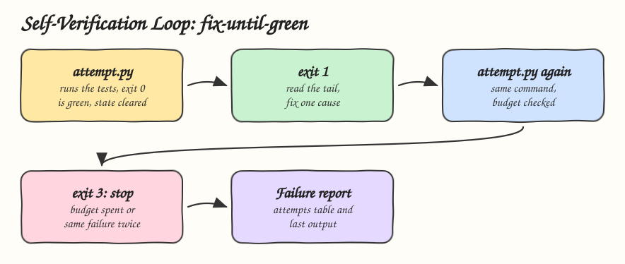

# 17 - Self-Verification Loop

Pattern: let the agent test, repair and test again, but put the loop's budget and stop rules in code so it ends with a result or a report, never in an endless retry. Skill: `fix-until-green`, which fixes failing tests in at most N attempts.

## How it Works

1. Every test run goes through `attempt.py`, which runs the command and records the attempt number, exit code and sha256 of the output in `.fix-until-green.json`.
2. Exit 0 means green. The state file is deleted, so the next task starts with a fresh budget.
3. Exit 1 means failed with attempts left. The agent reads the output tail and fixes one cause.
4. Exit 3 means stop: the budget is spent, or the output is byte for byte the same as the previous attempt, so the last fix changed nothing.
5. On stop, `fix-until-green-report.md` gets a table of every attempt and the last output.
6. Once the budget is spent the script refuses to run the tests again, and a different command is refused while the state exists, so the budget cannot be reset by rephrasing.

## Architecture



## The Skill

| File | What it is |
|---|---|
| `skill/SKILL.md` | The loop, the exit codes and the rules against fake fixes |
| `skill/scripts/attempt.py` | Attempt counter, stop rules and failure report |
| `tests/test_attempt.py` | Green clears state, the budget is enforced, no progress stops early, the budget cannot be reset |

## Run

```bash
python3 skill/scripts/attempt.py --max 3 -- uv run pytest -q
```

```
1 failed, 12 passed
attempt 1/3 failed, fix the cause and run again
```

## Install

```bash
./install.sh          # asks: 1) Claude 2) Codex 3) Both
./uninstall.sh both
```

## Use

```
make the tests pass
```

## Trade-offs

* "Same output" is an exact hash. Output with timings or random ids never matches, so only the budget stops those loops.
* The script cannot tell a real fix from a deleted test. The rules forbid it, and [09 - Skill Contract Testing](../09-skill-contract-testing) or a review catches it.
* Deleting the state file resets the budget. The skill forbids it. A hook could enforce it, see [19 - Policy-as-Code Guardrails](../19-policy-as-code-guardrails).
