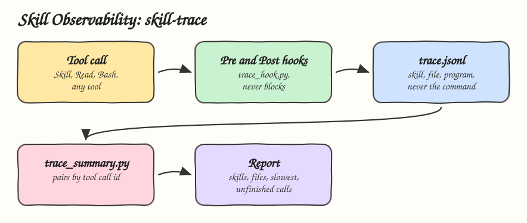

# 18 - Skill Observability

Pattern: trace what the agent actually did, from outside the model: which skill ran, which files it loaded, which tools it called and how long they took. Skill: `skill-trace`, hooks that write a JSONL trace plus a summary the agent answers from.

## How it Works

1. `trace_hook.py` runs as a PreToolUse and PostToolUse hook for every tool and appends one JSON line per event to `~/.skill-trace/trace.jsonl`.
2. Each line has the time, the event, the session, the tool and the tool call id, plus the skill name for `Skill` calls, the path for file tools and only the first word of a Bash command.
3. Full commands, file contents and tool output are never written, so a token in a `curl` header never reaches the trace.
4. The hook never blocks the agent. If it cannot write, it exits 1 and Claude Code shows the error without stopping the tool.
5. `trace_summary.py` pairs Pre and Post events by tool call id and reports skill runs, files loaded, calls per tool, the slowest call of each tool, and calls with no finish event, which are denied, failed or interrupted calls.
6. The skill answers "what did you do" questions from that summary, never from memory.

## Architecture



## The Skill

| File | What it is |
|---|---|
| `skill/SKILL.md` | What is recorded, how to report, what never to record |
| `skill/scripts/trace_hook.py` | The hook, one JSON line per event |
| `skill/scripts/trace_summary.py` | Skills, files, tools, slowest, unfinished |
| `skill/hooks.json` | Hook registration to merge into `~/.claude/settings.json` |
| `tests/test_trace.py` | No secrets in the trace, summary math, one line per event, never blocks |

## Verified in a real session

A `claude -p` session with this hook and the [19](../19-policy-as-code-guardrails) guard, asked to run `rm -rf build`:

```
{"ts": 1793113354.31, "event": "PreToolUse", "session": "0f99571a-...", "tool": "Bash", "id": "toolu_011tDH5j...", "program": "rm"}
```

```
| Tool | Calls | Slowest s |
|---|---|---|
| Bash | 1 | 0.00 |

calls with no finish event: 1
```

The real hook input carries `tool_use_id`, and the blocked call shows up as unfinished.

## Install

```bash
./install.sh          # asks: 1) Claude 2) Codex 3) Both
./uninstall.sh both
```

Then merge `skill/hooks.json` into the `hooks` of `~/.claude/settings.json`. Set `SKILL_TRACE_FILE` for another trace path.

## Use

```
which skills did you use in this session and what was slow?
```

## Trade-offs

* Hooks are a Claude Code feature. Codex has no equivalent wired here, so the skill reports that the trace is missing.
* The trace grows forever. Rotate it like any log.
* Token cost per skill is not in the hook input. It needs the session transcript or the API usage data.
