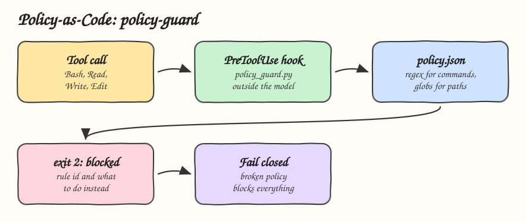

# 19 - Policy-as-Code Guardrails

Pattern: write engineering rules as machine checked policy and enforce them outside the model, before the tool call runs. Skill: `policy-guard`, a PreToolUse hook that checks every Bash and file call against `policy.json`.

## How it Works

1. `policy.json` holds the rules. Each has an id, the tools it applies to, a reason, and a `deny_command` regex or a `deny_path` glob.
2. `policy_guard.py` runs as a PreToolUse hook for Bash, Read, Write and Edit and evaluates every rule.
3. A violation exits 2. Claude Code blocks the call and shows the agent `blocked by policy <id>: <reason>`, and the reason says what to do instead.
4. `allow_new_files` lets a rule protect existing files only: applied migrations cannot change, a new migration can be added.
5. A policy file that cannot be read or parsed blocks everything. The guard fails closed, never open.
6. The skill explains blocks and helps change rules. It cannot turn the guard off.

## Shipped rules

| Rule | Blocks |
|---|---|
| `no-recursive-force-delete` | `rm -rf`, `rm -fr`, `rm -r -f`, `--recursive --force` |
| `no-force-push` | `git push --force`, `-f`, `--force-with-lease` |
| `no-pipe-to-shell` | `curl ... \| sh`, `wget ... \| sudo bash` |
| `migrations-are-append-only` | Edit or overwrite of an existing file in `migrations/` |
| `no-env-files` | Read, Edit or Write of `.env*` |

## Architecture



## The Skill

| File | What it is |
|---|---|
| `skill/SKILL.md` | What to do when blocked, how to change a rule |
| `skill/policy.json` | The rules |
| `skill/scripts/policy_guard.py` | PreToolUse hook, exit 2 blocks, fails closed |
| `skill/hooks.json` | Hook registration to merge into `~/.claude/settings.json` |
| `tests/test_policy_guard.py` | Every rule, safe lookalikes, new migrations allowed, fail closed |

## Verified in a real session

`claude -p` with the hook in `--settings`, asked to run `rm -rf build`:

```
PreToolUse:Bash hook error: [...policy_guard.py]: blocked by policy no-recursive-force-delete: recursive force delete can wipe a tree, delete named files one by one or ask the user
```

`build/` was still there afterwards.

## Install

```bash
./install.sh          # asks: 1) Claude 2) Codex 3) Both
./uninstall.sh both
```

Then merge `skill/hooks.json` into the `hooks` of `~/.claude/settings.json`. Pass another policy path as the first argument of the hook command to use a project policy.

## Use

```
why was my rm blocked?
add a rule that blocks DROP TABLE in psql commands
```

## Trade-offs

* Regexes over shell commands can be bypassed by an agent that tries hard: a variable, an alias, base64. The guard stops accidents and honest mistakes, a sandbox stops the rest, see [13 - Sandboxed Execution](../13-sandboxed-execution).
* Hooks are a Claude Code feature. In Codex the rules are only instructions, use its sandbox and approval policy.
* A GitHub issue from December 2025 reported exit 2 not blocking Write and Edit on some versions. On Claude Code 2.1.311 a Write over `db/migrations/001_users.sql` was blocked and the file was unchanged. Check file tools on your version.
