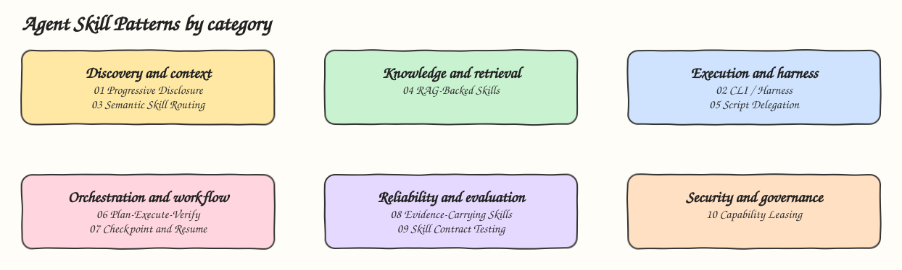

# Agent Skill Patterns

Nineteen architecture patterns for agent skills. Each pattern is a real, installable skill for Claude Code and Codex, in its own folder with a README, a diagram, and `install.sh` / `uninstall.sh`. Code ships only where the pattern needs it: the harness, retrieval, script delegation, the evidence recorder, the contract checker, the log compressor, the manifest verifier, the sandbox runner, the chain validator, the attempt counter and the three hooks.

## How it Works

A skill is a package of instructions, references and scripts that an agent discovers, loads and runs when needed. The patterns are not steps in a sequence. They are independent design choices grouped by the concern they address, and a single skill usually combines several of them.

## Architecture



## Patterns

| # | Pattern | Skill | What the skill shows |
|---|---|---|---|
| 01 | [Progressive Disclosure](01-progressive-disclosure) | `sql-migration` | Metadata always, body when picked, one engine reference out of four only when needed |
| 02 | [CLI / Harness](02-cli-harness) | `calc-harness` | CLI with three modes: `/calc` code only, `/english` LLM parses and code computes, `/ask` LLM decides |
| 03 | [Semantic Skill Routing](03-semantic-skill-routing) | `ops-router` | Routes by meaning to one of five runbooks, asks instead of guessing, routing evals |
| 04 | [RAG-Backed Skills](04-rag-backed-skills) | `team-handbook` | BM25 retrieval over the team handbook, answers only with citations |
| 05 | [Deterministic Script Delegation](05-deterministic-script-delegation) | `invoice-total` | Money math in a script with exact decimals, only JSON enters the context |
| 06 | [Plan-Execute-Verify](06-plan-execute-verify) | `verified-change` | `plan.md` with a check per step, one step at a time, done only when every check passed |
| 07 | [Checkpoint and Resume](07-checkpoint-and-resume) | `resumable-task` | `.agent-checkpoint.md` saved per step, a new session resumes without redoing work |
| 08 | [Evidence-Carrying Skills](08-evidence-carrying-skills) | `proof-of-done` | A recorder writes exit codes and sha256 hashes to `evidence.md`, never the model |
| 09 | [Skill Contract Testing](09-skill-contract-testing) | `conventional-commit` | Written contract, deterministic checker, and evals run against Claude and Codex |
| 10 | [Least-Privilege Capability Leasing](10-least-privilege-capability-leasing) | `log-cleanup` | `allowed-tools` leases three exact commands, everything else prompts |
| 11 | [Context Budgeting and Compression](11-context-budgeting) | `log-triage` | A script shrinks a huge log to error groups, counts, head and tail inside a fixed budget |
| 12 | [Skill Supply-Chain Verification](12-skill-supply-chain-verification) | `trusted-install` | A publisher pinned sha256 manifest, install refused on any modified, missing or unlisted file |
| 13 | [Sandboxed Execution](13-sandboxed-execution) | `untrusted-run` | podman with no network, a read-only mount, no credentials and resource limits |
| 14 | [Skill Chaining](14-skill-chaining) | `csv-to-report` | Link one writes a fixed JSON schema, link two accepts only that schema |
| 15 | [Parallel Skill Fan-Out](15-parallel-skill-fan-out) | `multi-lens-review` | Four blind subagents review in parallel, a merge deduplicates by `file:line` |
| 16 | [Human Approval Gates](16-human-approval-gates) | `prod-deploy` | A PreToolUse hook blocks prod deploys until a human approves that exact command |
| 17 | [Self-Verification Loop](17-self-verification-loop) | `fix-until-green` | Test, fix, test again, stopped by a script after N attempts or no progress |
| 18 | [Skill Observability](18-skill-observability) | `skill-trace` | Hooks write skills, files and tool timings to JSONL, a summary answers what happened |
| 19 | [Policy-as-Code Guardrails](19-policy-as-code-guardrails) | `policy-guard` | A PreToolUse hook enforces `policy.json` rules and fails closed |

## Categories

| Category | Patterns | Concern |
|---|---|---|
| Discovery and context | 01, 03, 11 | Keep context small and pick the right procedure as skills grow |
| Knowledge and retrieval | 04 | Retrieve changing facts instead of memorizing them |
| Execution and harness | 02, 05, 13 | Move control and computation out of the prompt into code, and isolate code you did not write |
| Orchestration and workflow | 06, 07, 14, 15, 16 | Make multi step work checkable, restartable, composable, parallel and approved |
| Reliability and evaluation | 08, 09, 17, 18 | Turn "the agent said it is done" into something verifiable and observable |
| Security and governance | 10, 12, 19 | Give a skill only the permissions its job needs, trust only verified skills, enforce rules outside the model |

## Install

Every pattern installs on its own. With no argument the installer asks for Global Claude, Global Codex or both.

```bash
./02-cli-harness/install.sh
./02-cli-harness/install.sh claude
./02-cli-harness/install.sh codex
./02-cli-harness/install.sh both
./02-cli-harness/uninstall.sh both
```

Skills install to `~/.claude/skills/<skill>` and `~/.codex/skills/<skill>`.

Patterns 16, 18 and 19 also ship a `skill/hooks.json`. Merge it into the `hooks` of `~/.claude/settings.json` to turn the enforcement on, the installers never edit settings. Hooks are a Claude Code feature, in Codex those three skills are instructions only.

Pattern 12 verifies its own `skill/MANIFEST.sha256` before installing. After changing a file under its `skill/`, run `python3 12-skill-supply-chain-verification/skill/scripts/skill_manifest.py create 12-skill-supply-chain-verification/skill`.

## Stack

* Python 3.15: the scripts that ship inside skills, standard library only, so an installed skill runs with plain `python3`.
* Bash: install, uninstall, the evidence recorder and the manifest check in pattern 12's installer.
* podman: the sandbox in pattern 13.
* uv: the development environment for tests and type checks.
* ty: static type checking of every script and test.
* pytest: tests for every script plus a structure test for every skill.

## Tests

`tests/test_skills.py` checks every skill: frontmatter with a `Use when` description, a name that matches its installer, every file the skill tells the agent to load exists, and install and uninstall for Claude, Codex and both. Patterns with code have their own `tests/` folder. The live sandbox tests in pattern 13 need podman and are skipped without it.

## Scripts

All scripts live in `scripts/` and run from any directory of the repository. The skills have no servers, so there are no ports, start, stop, status or UI scripts.

| Script | What it does |
|---|---|
| `./scripts/setup.sh` | Installs the development environment with `uv sync` |
| `./scripts/test-all.sh` | Runs `ty check` and every pytest suite |

```bash
./scripts/setup.sh
./scripts/test-all.sh
```
