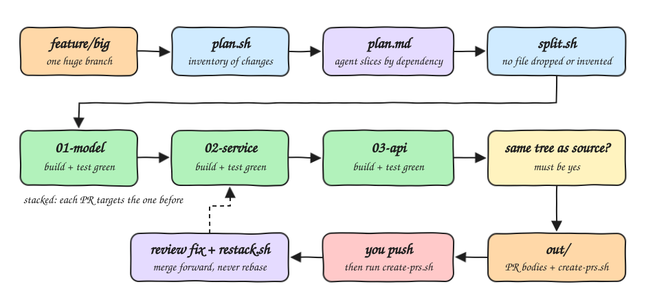

# pr-splitter

Skill that breaks one large branch into a chain of small, reviewable stacked PRs. Every PR builds
and passes its tests on its own, and the last PR has exactly the same tree as the original branch,
so the split never loses or changes code.

## How it Works

1. `plan.sh` writes an inventory of every changed file with its added and removed lines.
2. The agent reads the diff and the code and writes `plan.md`, grouping the files into slices ordered
   by dependency: schema, model, logic, API, UI, docs. Tests travel with the code they test.
3. When one file must land in two slices, the agent writes a partial patch for the earlier slice.
4. `split.sh` refuses any plan that drops or invents a file, then creates one branch per slice, each
   stacked on the previous one, and runs build and tests on every branch.
5. A red slice stops the split, names the slice and points to its log. The agent fixes the plan and
   runs it again.
6. At the end `split.sh` checks that the last branch is identical to the source branch.
7. It writes one PR body per slice (task, prompt, real test output) and `create-prs.sh` with the
   `gh pr create` commands. Nothing is pushed.
8. After review, `restack.sh` merges each slice into the next and reruns the checks. It never rebases.

## Architecture



## Features

* **Lossless split**: the last slice must equal the source tree, so no change is dropped or edited.
* **Green slices**: every branch builds and passes the tests alone, so each PR can merge by itself.
* **Coverage check**: a file left out, listed twice or not changed by the source stops the split before any branch exists.
* **Partial files**: `patch` lines land part of a file early and a later slice finishes it.
* **Stacked PRs**: each PR targets the previous slice, so reviewers see only that slice's diff.
* **Merge only**: review fixes move forward with merge commits, never with rebase.
* **No push**: the user pushes, then runs `create-prs.sh`.
* **Nothing committed by accident**: plan, patches and output live in `.git/pr-split/`.

## Stack

* **bash 3.2**: runs on a stock macOS and Linux without extra installs.
* **git**: does all the slicing with `checkout`, `apply`, `merge` and `diff`.
* **gh**: opens the stacked PRs, only when the user runs `create-prs.sh`.

## Contracts

| Script | Arguments | Output |
|---|---|---|
| `scripts/plan.sh` | `<base> <source>` | `.git/pr-split/<source>/inventory.txt` and a starter `plan.md` |
| `scripts/split.sh` | `<plan.md>` | branches `split/<source>/NN-<slug>`, `out/NN.md`, `out/NN.log`, `out/create-prs.sh` |
| `scripts/restack.sh` | `<plan.md>` | merges forward, refreshed `out/` |
| `scripts/cleanup.sh` | `<source>` | deletes `split/<source>/*` and `out/`, keeps the plan |
| `scripts/test-all.sh` | none | runs the engine test suite |

Plan format:

```
base: main
source: feature/big
build: mvn -q compile
test: mvn -q test
prompt: prompt.md

## user model
> Adds the User model the service needs.
src/main/java/app/User.java
src/test/java/app/UserTest.java
patch patches/service-part1.patch

## user service
> Adds the user service on top of the model.
src/main/java/app/UserService.java
src/main/java/app/Service.java
```

## Design Decisions

* Slices are described by files, not by commits, so a messy history still splits cleanly.
* A bare path always takes the final version from the source, which is what makes the last slice equal the source.
* Patches are applied before bare paths, so a patch can never undo a final version.
* Every script exits non-zero and says what failed; success requires `same tree as <source>: yes`.

## Sample

A real split of one big branch into 3 stacked PRs, run against this repository.

* [sample/big-pr](sample/big-pr): the big PR, a bash ledger with money, ledger and CLI layers and 18 tests, opened as [#4 big ledger PR](https://github.com/diegopacheco/agent-skills/pull/4) (9 files, +135, 18 green).
* [sample/plan.md](sample/plan.md): the plan the agent wrote, with [sample/prompt.md](sample/prompt.md) and the partial README patch [sample/patches/readme-money.patch](sample/patches/readme-money.patch).
* [sample/splited-prs](sample/splited-prs): one folder per slice with the files exactly as that PR has them and the `PR.md` body `split.sh` wrote, with the real test output.

| PR | Folder | Base | Files | Lines | Tests |
|---|---|---|---|---|---|
| [#1 money in integer cents](https://github.com/diegopacheco/agent-skills/pull/1) | [01-money-in-integer-cents](sample/splited-prs/01-money-in-integer-cents) | `main` | 5 | +47 | 8 green |
| [#2 ledger on top of money](https://github.com/diegopacheco/agent-skills/pull/2) | [02-ledger-on-top-of-money](sample/splited-prs/02-ledger-on-top-of-money) | PR #1 | 2 | +43 | 14 green |
| [#3 ledger cli and docs](https://github.com/diegopacheco/agent-skills/pull/3) | [03-ledger-cli-and-docs](sample/splited-prs/03-ledger-cli-and-docs) | PR #2 | 3 | +45 | 18 green |

`split.sh` printed `same tree as pr-splitter-sample: yes`. The `README.md` lands in PR #1 with only the Money section
through the patch and reaches its final version in PR #3. Copying the 3 folders over each other gives back `big-pr`
byte for byte. The 3 slices add up to the 9 files and +135 lines of #4. All 4 PRs were opened to test the split on
GitHub and then closed.

## How to Run

```bash
./install.sh both
./scripts/test-all.sh
```

Inside a repository, run `/pr-splitter` or `/pr-splitter feature/big main`.

```bash
./uninstall.sh both
```
