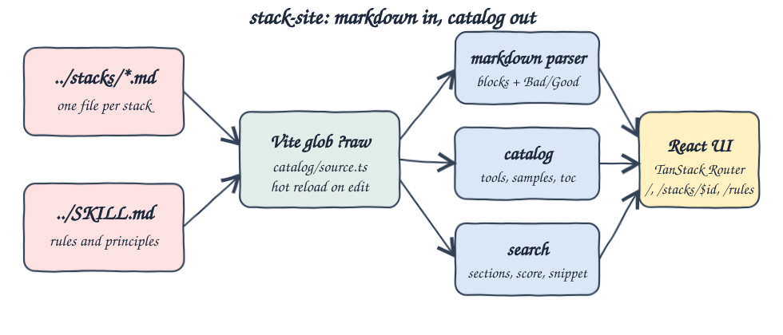
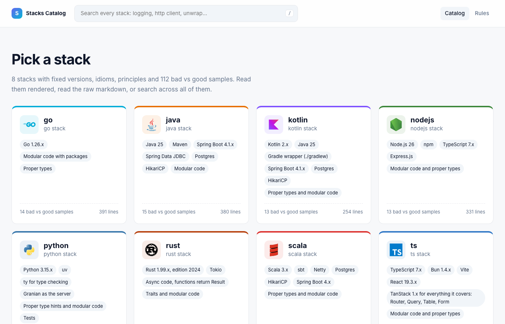
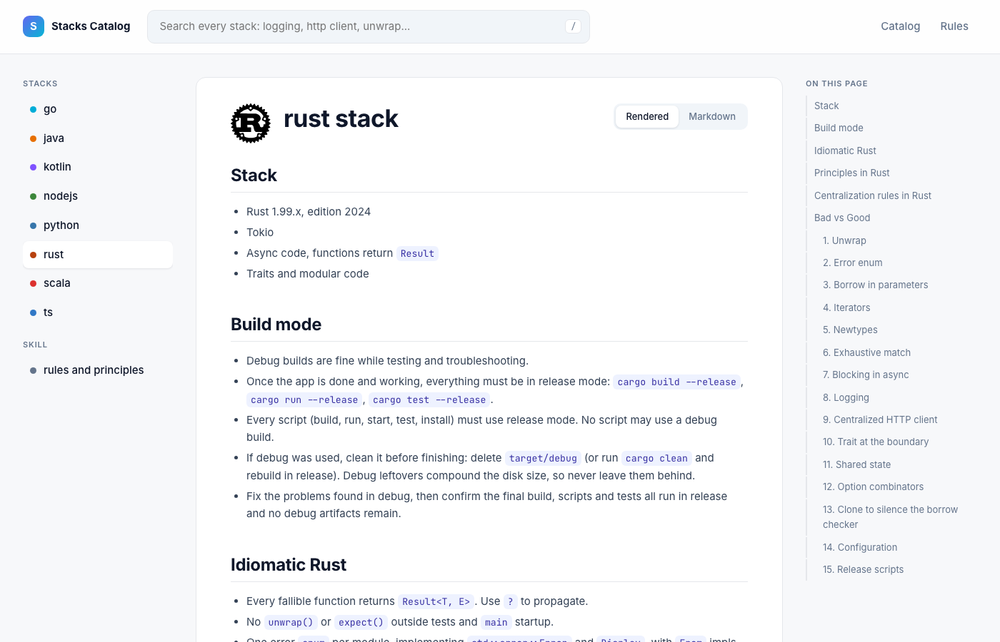
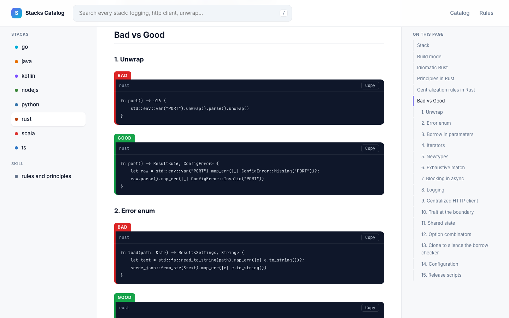
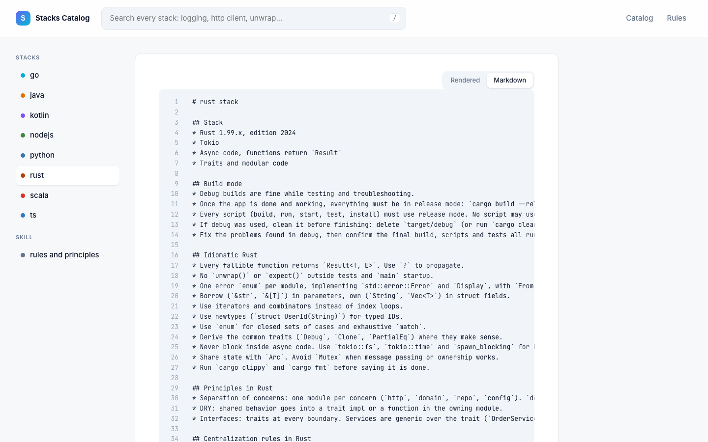
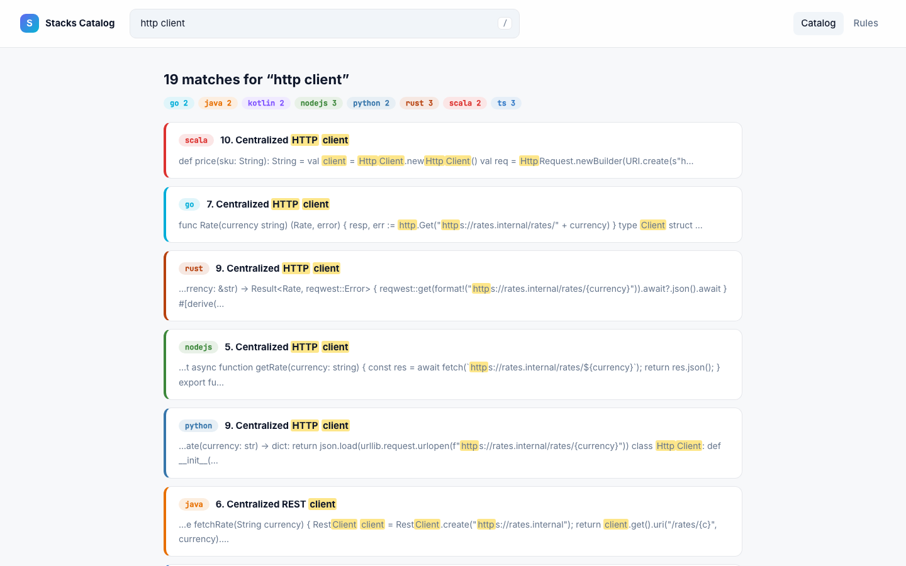
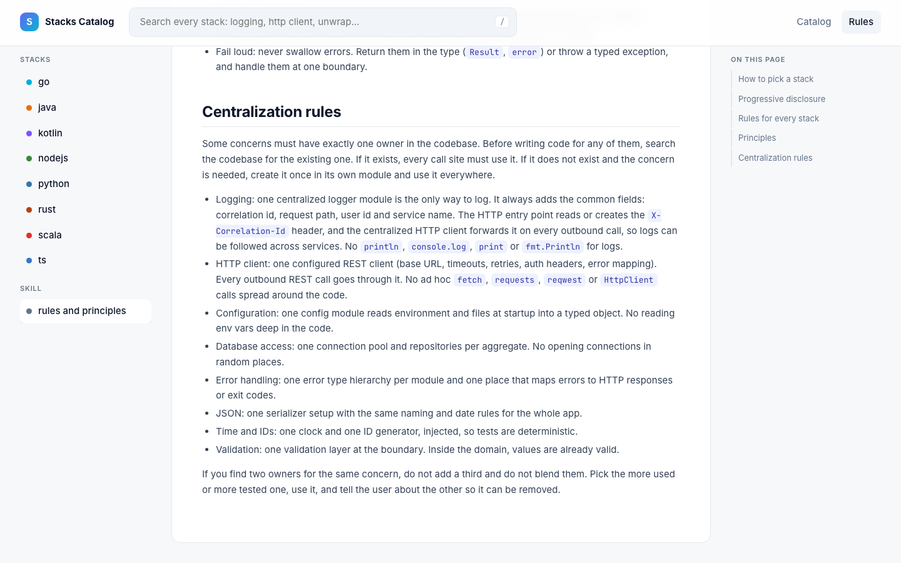

# stack-site

A local catalog to browse the stacks of `stacks-skill`. Pick a stack, read its markdown rendered or raw, and search across every stack, the rules and the bad vs good samples.

Published at https://diegopacheco.github.io/agent-skills/stacks-skill/catalog/

It is only for viewing. `install.sh` copies `SKILL.md` and `stacks/` only, so `stack-site/` is never installed with the skill.

## How it Works

1. Vite reads `../stacks/*.md` and `../SKILL.md` as raw text with `import.meta.glob`. Nothing is copied, and editing a stack file reloads the page.
2. A small markdown parser turns each file into typed blocks: headings, paragraphs, lists, tables and code.
3. A `Bad` or `Good` line before a code fence tags the code that follows it, so the samples render with red and green badges.
4. The catalog reads each file's `## Stack` list for the card tools, counts the `###` entries under `## Bad vs Good`, and builds the table of contents.
5. Search splits every file into sections at the h2 and h3 headings. Every term must match, and title matches rank first. Each result links to its section.

## Architecture



## Features

* Catalog grid: one card per stack with its language logo, its tools, versions and sample count, so you can compare stacks at a glance.
* Rendered view: the language logo, headings, tables, lists and code with copy buttons, and Bad vs Good samples marked in red and green.
* Markdown view: the raw file with line numbers, so you see exactly what the agent reads.
* Search: searches every stack at once, highlights matches, counts hits per stack and jumps to the section. Press `/` to focus it.
* Rules page: `SKILL.md` rendered, with its stack table linking to each stack page.
* Sidebar and table of contents: switch stacks and jump to sections without scrolling.
* Live: editing a file in `stacks/` updates the open page.

## Stack

Built with the `ts` stack from this skill (`stacks/ts.md`).

* TypeScript 7.0.2 with `strict`: typed blocks and exhaustive `switch` over discriminated unions.
* Bun 1.4.4: installs packages, runs scripts and runs the tests with `bun test`.
* Vite 8.3.8: dev server, reads the markdown files from the parent folder and builds the site.
* React 19.3.1: function components with typed props.
* TanStack Router 1.x: file-based routes with typed params and typed search (`?q=`, `?view=source`).

No markdown library. The parser is about 100 lines and is covered by tests. TanStack Query, Table and Form are not used because there is no server data, no data table and no form.

## Routes

Routes use hash history, so the site works from any subpath, such as GitHub Pages.

| Route | What it shows |
|---|---|
| `#/` | Catalog grid |
| `#/?q=<terms>` | Search results across every stack |
| `#/stacks/$stackId` | One stack rendered, with sidebar and table of contents |
| `#/stacks/$stackId?view=source` | The raw markdown with line numbers |
| `#/rules` | `SKILL.md` rendered |

## Key design decisions

* `features/markdown`: `parse.ts` and `inline.ts` turn text into `Block` and `Inline` unions. React components only render blocks and never parse.
* `features/catalog`: `catalog.ts` is pure and gets files as `Record<path, source>`, so tests run without Vite. Only `source.ts` knows about `import.meta.glob`.
* `features/search`: pure functions over the catalog, scored by term count with a bonus for title matches.
* `logo.ts` maps a stack id to its SVG in `src/assets/logos/`, so Vite bundles each logo with the build.
* Search text lives in the URL, so a search can be shared and the back button works.

## Layout

```
stack-site/
  scripts/                  setup, start, stop, status, test, ui
  src/
    main.tsx                router setup
    routes/                 __root, index, stacks.$stackId, rules
    features/markdown/      parser, inline parser, slugs, render components
    features/catalog/       catalog builder, source glob, cards, nav, toc
    features/search/        search, highlight, results
    components/SearchBox.tsx
    assets/logos/           transparent SVG language logos from devicon
  docs/architecture.svg
  printscreens/
```

## Screenshots

### Catalog

Each card shows a stack's tools from its `## Stack` section, the number of bad vs good samples and the file size.

### Stack page

The rust stack rendered. On the left you switch stacks. On the right is the table of contents for this file.

### Bad vs Good

Each sample shows the wrong code with a red BAD badge and the right code with a green GOOD badge. Every code block has a copy button.

### Markdown source

The Markdown toggle shows the raw file with line numbers, as the agent reads it.

### Search

`http client` matches the centralized HTTP client sample in every stack. Chips count hits per stack, and matches are highlighted.

### Rules

`SKILL.md` rendered. The description from the front matter is shown at the top, and the table links to each stack page.

## Scripts

All scripts live in `scripts/` and run from any directory of the repository.

| Script | What it does |
|---|---|
| `./scripts/setup.sh` | Installs dependencies and prepares the app |
| `./scripts/start-all.sh` | Starts every service and prints the full link of each one |
| `./scripts/status.sh` | Shows every service port as UP or DOWN |
| `./scripts/test-all.sh` | Runs every test suite |
| `./scripts/ui.sh` | Opens the UI in the browser |
| `./scripts/stop-all.sh` | Stops every service |

Ports are declared in `scripts/ports.env`. The site runs on `http://localhost:5180`.

`test-all.sh` runs the unit tests (`bun test`), the typecheck (`tsc --noEmit`) and the production build.

## Publish

The site is served by GitHub Pages from the `docs/` folder of the `main` branch. To publish a new version, build and copy `dist/` to `docs/stacks-skill/catalog/`, then push `main`.

```bash
./scripts/test-all.sh
rm -rf ../../docs/stacks-skill/catalog && mkdir -p ../../docs/stacks-skill/catalog && cp -R dist/. ../../docs/stacks-skill/catalog/
```

```bash
./scripts/setup.sh
./scripts/start-all.sh
./scripts/status.sh
./scripts/ui.sh
./scripts/stop-all.sh
```
