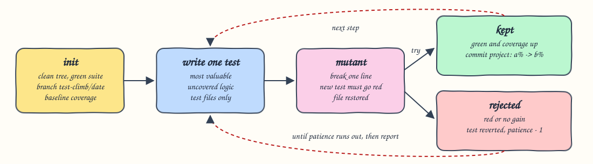
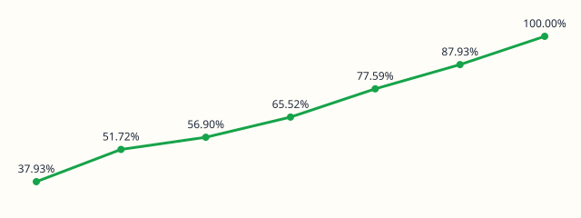

<p align="center"></p>

# test-climb

A skill for Claude Code and Codex that hill climbs test coverage one test at a time. Each step adds one test, proves the test can fail by breaking the production code on purpose, and is kept only if the suite stays green and coverage goes up. Anything else is reverted.

## The hill climbing technique

Hill climbing is the simplest search there is: stand somewhere, take one small step, keep it if you went up, undo it if you did not, and stop when no step goes up anymore. test-climb climbs coverage that way:

| Hill climbing | In test-climb |
|---|---|
| Position | The test suite on the `test-climb/<date>` branch |
| Height | The coverage percentage the project's own tool prints |
| One step | One new test file, nothing else changes |
| Valid step | The suite stays green and the new test kills a mutant, so it can fail when the logic breaks |
| Uphill | Coverage strictly higher than the best so far: commit it |
| Not uphill | Red suite or equal coverage: revert it |
| Top | `--patience` steps in a row without gain, or 100% |

Greedy and one step at a time on purpose: every commit is a small, reviewable test that made the number go up, and nothing that did not survives on the branch.

## How it Works

1. `climb.sh init` checks for a clean tree and a green suite, creates the branch `test-climb/<date>` and measures the baseline coverage.
2. The agent reads the coverage report and writes one test for the most valuable uncovered logic.
3. `climb.sh mutant` breaks one line of the code under test (`>=` to `>`, `0.9` to `0.8`), runs only the new test, and restores the file. The test must go red. If it stays green the assertion is weak and the agent fixes it.
4. `climb.sh try` refuses the step if anything besides the listed test files changed, or if no mutant was killed. It runs the suite and the coverage. Green and higher is committed. Red or equal is reverted.
5. After N steps in a row without gain, `climb.sh report` writes `climb-report.md` with a chart and commits it. The user merges the branch.

## Architecture

<p align="center"></p>

## Features

* **One test per step**: small steps are easy to review and easy to revert.
* **Mutant gate**: a test that cannot fail when the logic breaks never counts, so coverage cannot be gamed with assertion-free tests.
* **Strictly up**: equal coverage is a rejection, so each commit adds real coverage.
* **Tests only**: a step that touches production code is refused.
* **Patience**: stops after N steps without gain instead of grinding forever.
* **Git like git-gh-skill**: its own branch, one commit per kept step prefixed with the project name, merge only, never rebase, never push.
* **scripts-skill aware**: uses `scripts/test-all.sh` as the suite when it exists.
* **Report**: a table of every step, kept or rejected, plus an SVG chart of coverage over the climb.

## Stack

* **Bash**: `scripts/climb.sh`, no dependencies besides git and awk.
* **Coverage tools of the project**: `references/coverage.md` has one command per stack (node:test, Bun, Jest, Vitest, pytest-cov, Go, cargo llvm-cov, JaCoCo with Maven or Gradle, sbt-scoverage) that prints one percentage.

## Commands

| Command | What it does |
|---|---|
| `climb.sh init --coverage '<cmd>' [--test '<cmd>'] [--patience 5]` | Branch, green check, baseline |
| `climb.sh mutant <src> <line> '<from>' '<to>' ['<test cmd>']` | Breaks one line, expects the test to fail, restores the file |
| `climb.sh try '<why>' <test-file>...` | Keeps and commits the step or reverts it |
| `climb.sh status` | Baseline, best, last steps, continue or stop |
| `climb.sh report` | Writes and commits `climb-report.md` and `climb-chart.svg` |
| `climb.sh end` | Removes the local `.test-climb/` state, keeps the branch |

## Design decisions

* The state lives in `.test-climb/`, added to `.git/info/exclude`, so it never shows up in `git status` and is never committed.
* Coverage is read as the last `NN.N%` the command prints, so any stack plugs in with one command.
* The mutant restores the file from a backup in a trap, so a crash in the middle still leaves the production code untouched.

## Sample

[`sample/`](sample) is a small invoice library (subtotals, discount tiers, tax by state, shipping, coupons) that ships with one test. test-climb was run on a git copy of it, for real, with `--patience 2`. Everything it produced is in [`sample/results/`](sample/results): the [report](sample/results/climb-report.md), the [chart](sample/results/climb-chart.svg), the [kept tests](sample/results/tests) and the [full transcript](sample/results/transcript.md) of every command and its output.

<p align="center"></p>

Coverage went from **37.93%** to **100.00%** in 6 kept steps. 2 steps were rejected, and patience stopped the climb.

| Step | Result | Coverage | Test | Mutants killed |
|---|---|---|---|---|
| 0 | baseline | 37.93% | the one test it shipped with | - |
| 1 | kept | 51.72% | discount tiers start exactly at 500 and 1000 | `>= 1000` to `> 1000`, `>= 500` to `> 500` |
| 2 | kept | 56.90% | unknown states are taxed at the default rate, never zero | `?? TAX.DEFAULT` to `?? 0` |
| 3 | kept | 65.52% | free shipping starts at 300 and extra items cost 2 each | `>= 300` to `> 300`, `items - 3` to `items - 2` |
| 4 | kept | 77.59% | the total is rounded to cents after discount, tax and shipping | `* 100) / 100` to `* 10) / 10`, `tax(net)` to `tax(sub)` |
| 5 | kept | 87.93% | a coupon can never take 100 percent or more | `{1,2}` to `{1,3}` |
| 6 | kept | 100.00% | a coupon expires after its last day, not on it | `today >` to `today >=` |
| 7 | no-gain | 100.00% | large orders get exactly 10 percent | reverted |
| 8 | no-gain | 100.00% | an empty invoice costs nothing | reverted, stop |

The mutant gate caught a weak test on the way. The first shipping test only asserted `shipping(100, 5) > 0`:

```
$ climb.sh mutant src/invoice.mjs 30 "items - 3" "items - 2" "node --test test/shipping.test.mjs"
survived: src/invoice.mjs:30 'items - 3' -> 'items - 2'. The tests pass with broken code, strengthen the assertion
```

It was rewritten to assert exact values at the 300 boundary and for items above 3, and both mutants were killed before the step was kept. The climb branch ended with one commit per kept step plus the report:

```
invoice: test-climb report 37.93% -> 100.00%
invoice: test-climb 87.93% -> 100.00% a coupon expires after its last day, not on it
invoice: test-climb 77.59% -> 87.93% a coupon can never take 100 percent or more
invoice: test-climb 65.52% -> 77.59% the invoice total is rounded to cents after discount, tax and shipping
invoice: test-climb 56.90% -> 65.52% free shipping starts at 300 and extra items cost 2 each
invoice: test-climb 51.72% -> 56.90% unknown states are taxed at the default rate, never zero
invoice: test-climb 37.93% -> 51.72% discount tiers start exactly at 500 and 1000
```

`test.sh` checks that these results are real: the sample measures 37.93% on its own, and 100.00% with the kept tests copied in.

## How to run

```
./install.sh            asks for Claude, Codex or both
./install.sh claude     or codex, or both
./uninstall.sh both
./test.sh               runs the tests
```

Then in a repository: `/test-climb` in Claude Code or `$test-climb` in Codex.

`test.sh` builds a small Node.js shop in a temp git repo and climbs it for real with node:test coverage: a boundary mutant killed and kept, a weak test whose mutant survives, a duplicate test rejected for no gain, a step touching production code refused, a red suite rejected, patience reached, the report committed, and `main` never touched.
