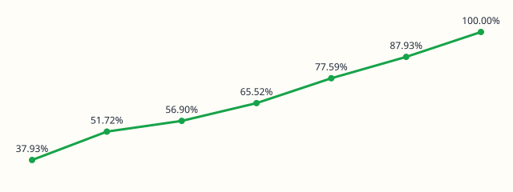

# test-climb report

Branch `test-climb/2026-11-24-1537`. Coverage went from **37.93%** to **100.00%** in 6 kept steps, 2 rejected.

Every kept test killed at least one mutant: the production code was broken on purpose and the test failed.

| Step | When | Result | Coverage | Best | Files | Why |
|---|---|---|---|---|---|---|
| 0 | 2026-11-24 15:37 | baseline | 37.93 | 37.93 | - | suite green before climbing |
| 1 | 2026-11-24 15:37 | kept | 51.72 | 51.72 | test/discount.test.mjs | discount tiers start exactly at 500 and 1000 |
| 2 | 2026-11-24 15:37 | kept | 56.90 | 56.90 | test/tax.test.mjs | unknown states are taxed at the default rate, never zero |
| 3 | 2026-11-24 15:37 | kept | 65.52 | 65.52 | test/shipping.test.mjs | free shipping starts at 300 and extra items cost 2 each |
| 4 | 2026-11-24 15:37 | kept | 77.59 | 77.59 | test/total.test.mjs | the invoice total is rounded to cents after discount, tax and shipping |
| 5 | 2026-11-24 15:37 | kept | 87.93 | 87.93 | test/coupon.test.mjs | a coupon can never take 100 percent or more |
| 6 | 2026-11-24 15:37 | kept | 100.00 | 100.00 | test/apply-coupon.test.mjs | a coupon expires after its last day, not on it |
| 7 | 2026-11-24 15:37 | no-gain | 100.00 | 100.00 | test/discount-big.test.mjs | large orders get exactly 10 percent |
| 8 | 2026-11-24 15:37 | no-gain | 100.00 | 100.00 | test/subtotal-empty.test.mjs | an empty invoice costs nothing |

Merge with `git merge --no-ff test-climb/2026-11-24-1537`. Nothing was pushed.
